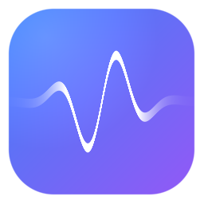

<p align="center"></p>

# RLPlayer

macOS 上的高保真播放引擎：升频、噪声整形、SDM/DSD 调制、卷积与 20 段 PEQ 全链路自研，每一步都给出可复现的实测数字。

[](#系统要求)
[](https://github.com/BH2VOQ/RLPlayer-Mac/releases)
[](#测试)


---

## 特性

### 信号链

- **多相 sinc 升频** — 任意有理比率，52 个命名预设；实测阻带 **−189.1 dB**、通带纹波 **0.0000 dB**
- **滤波器家族** — Kaiser / Gaussian / Blackman-Harris 三种窗，线性 / 最小 / 混合相位，tight 变体；抽头数与截止可调
- **抖动与噪声整形** — NS1/NS4/NS5/NS9/LNS15 + RPDF/TPDF/Gauss1/Shaped；NS9 相对 TPDF 的带内收益在 44.1k→705.6k 为 **3.5→86.5 dB**
- **SDM 调制器** — 四族：Butterworth（DSD5/DSD7）、7 阶 Chebyshev、EC 误差反馈、AHM 多电平；EC-5 在 DSD256 带内 SNR **113.5 dB**
- **DSD 原生读取** — DSF/DFF 直接解析，不经 ffmpeg；DirectSDM 同速率逐位直通，大文件分块流式解码（1764000 帧逐样本一致）
- **卷积引擎** — 零延迟均匀分块 FFT，分块结果与直接卷积相对误差 **≤6.1e-14**
- **20 段 PEQ** — RBJ 双二阶，20 个中心频率取自 ISO 1/3 倍频程网格，节点可拖、自动前级防削波；单段 +6 dB 实测 **6.0000 dB**（44.1/48/96/192 kHz）
- **过载保护** — 过采样峰值检测（ISP）自动预衰减、音量渐变、DoP 音量锁 0 dB；满幅 / 瞬态 / 恢复三段都有回归

### 输出

- **CoreAudio 独占（Hog）** — AUHAL + Hog 抢占 + 物理格式锁定，避免系统混音器重采样；设备不支持目标格式时**如实报错，不静默替换**
- **CoreAudio 共享** — 独占不可用时的兜底，`bit_perfect()` 明确返回 false 并告知；16/24/32 bit 三种位深实测 **0 LSB** 偏差
- **DoP** — 24-bit 载波封装 DSD，macOS 上唯一的 DSD 输出路径；DoP 模式下绝不静默回退到共享
- **UPnP / DLNA** — 真实 SSDP 发现 + AVTransport 控制 + 本地供源，实测供源字节数与文件**逐字节相同**
- **Null** — 只跑 DSP 不开设备，所有离线测试与自动化验证都走它
- **三档官方预设** — 原音直通 / PCM 升频 / DSD 升频，按当前设备能力实时算出推荐档位并标注降级原因；后端另支持第四档 PCM→DSD（`profile=pcm2dsd`）

### 界面

- **单进程原生壳** — NSWindow + WKWebView，页面走自定义 `rlplayer://app/` scheme 交给进程内核心，**主进程不监听端口**（只有 UPnP 投放期间临时起一个本地供源服务）
- **三套主题 × 两套布局** — 深色 / 白色 / 浅蓝色，Apple Music 风与 Hi-Fi 工作台风各一套
- **九个设置页签** — 输入 / 输出 / PCM / SDM / 高级 / EQ / 元数据 / 流媒体 / 诊断；页签条固定、只有内容滚动
- **六态位完美徽标** — 直通、PCM→PCM、PCM→DSD、DSD→DSD 各自区分是否 bit-perfect，并给出降级原因
- **通栏窗口** — 隐藏标题栏 + FullSizeContentView 内容铺满，四边 5px 热区可拉伸

### 资料与工具

- **原生标签解析** — FLAC / WAV / MP3 / OGG 直接读，比走 ffprobe 快 **60×~250×**
- **CUE 整轨分轨** — UTF-16 / UTF-8 / GBK 编码与 1/75 帧索引
- **元数据补全** — QQ 音乐 / 网易云 / iTunes / lrclib / dizzylab 五源；播放时自动补标签、封面、歌词
- **在线封面抓取** — 内嵌图 → 网图 → 负缓存 7 天；断网不写负缓存，只有服务器明确说没有才记缺失
- **OPRA 耳机 EQ** — 内置 **6230** 款耳机目标曲线，一键写入 EQ 链
- **音频体检 CLI** — `rtahealth` 输出 TT DR / BS.1770 LUFS / LRA / 假无损检测（需从源码构建，不随 `.app` 分发）
- **自动更新** — 检查、下载、sha256 校验、安装、失败回滚；通道是公开的 GitHub 仓库，客户端零 token
- **一键反馈** — 设置 → 诊断里填问题描述，附诊断包直接提交；未配置时明确说"未配置"，不假装发送成功

---

## 界面

<table>
  <tr>
    <td width="50%"></td>
    <td width="50%"></td>
  </tr>
  <tr>
    <td><b>快速开始</b> — 三张能力卡片 + 三档官方预设，按当前设备能力实时算出推荐档位。</td>
    <td><b>专辑详情</b> — 整轨曲目列表，每行可收藏、可单独入队，顶部直接播放整张。</td>
  </tr>
  <tr>
    <td></td>
    <td></td>
  </tr>
  <tr>
    <td><b>艺术家</b> — 圆形封面网格，卡片上标注专辑数量。</td>
    <td><b>曲目</b> — 全库扁平列表，右上角可选排序方式，右侧「+」单曲入队。</td>
  </tr>
  <tr>
    <td></td>
    <td></td>
  </tr>
  <tr>
    <td><b>设置 · 输出</b> — Hog 模式一键切换，采样率与位深跟着设备协商，失败会报错。</td>
    <td><b>设置 · EQ</b> — 20 段曲线节点可拖，自动前级防削波，可存预设。</td>
  </tr>
</table>

---

## 安装

1. 到 [Releases](https://github.com/BH2VOQ/RLPlayer-Mac/releases) 下载 `RLPlayer-v<版本>-macOS-arm64.dmg`
2. 双击挂载，把 `RLPlayer` 拖进「应用程序」
3. 首次打开若提示「无法验证开发者」：右键 →「打开」，或到 `系统设置 → 隐私与安全性 → 仍要打开`

ad-hoc 签名，未做 Apple 公证。自用与内部分发没有问题。

### 系统要求

| | |
|---|---|
| 系统 | macOS 13.0 及以上 |
| 芯片 | Apple Silicon（arm64）**只支持 arm64**，不支持 Intel Mac |
| 依赖 | 无。`.app` 自带 ffmpeg / ffprobe 与 Metal 内核 |

---

## 从源码构建

```bash
# 前置：CMake ≥ 3.20、Xcode Command Line Tools
cmake -S . -B build-mac -DCMAKE_BUILD_TYPE=Release
cmake --build build-mac -j8
ctest --test-dir build-mac --output-on-failure     # 87/87

# 出 .app（脚本内做架构 / 部署目标 / 签名门禁，不达标直接失败）
bash tools/make_app_mac.sh
# → dist-mac/RLPlayer.app
```

---

## 测试

```bash
ctest --test-dir build-mac --output-on-failure
```

**87 套测试，实测 87/87 通过。** 覆盖 DSP 数值、输出路径、网络、元数据、UI 判定层与更新安装逻辑。

验证默认**不打开音频设备**：优先离线分析与 Null 后端；需要出声的用例电平一律 ≤ −60 dBFS。

部分指标不在 ctest 里（GPU 性能表、GPU 精度全矩阵、房间校正与体检的具体数值），那些由 `gpu_precision` 等探针手动跑，结果记在 `docs/`。

---

## 客观指标

以下数字全部来自本机实测（Apple M4 / macOS 27.0.1），不是估算。

| 项 | 实测 |
|---|---|
| 升频阻带衰减（44.1k → 384k） | **−189.10 dB** |
| 升频通带纹波 | **0.0000 dB** |
| 升频最大谐波 | **−134.54 dBc** |
| DSD 源抽取 THD+N（DSD64 → 176.4k） | **99.37 dB** |
| EC-5 带内 SNR（DSD256） | **113.5 dB** |
| AHM-8bit 带内 SNR（DSD256） | **131.6 dB** |
| 20 段 PEQ 单段 +6 dB | **6.0000 dB** |
| 分块 FFT 卷积 vs 直接卷积 | 相对误差 **≤6.1e-14** |
| CoreAudio 共享路径逐位比对 | 16/24/32 bit 全部 **0 LSB** |
| UPnP 供源字节数 | 与源文件**逐字节相同** |

---

## GPU

Metal 内核（`librtagpu.dylib`，运行时编译 MSL）**动态加载**：`dlopen` 失败就退回 CPU，不影响功能。

- **升频：值得开** — 44.1k → 352.8k 快 **29×**，44.1k → 384k 快 **5.5×**
- **卷积：默认关闭** — 生产形态每块只有 4096 样，远低于 GPU 盈亏平衡点（实测需 n ≥ 32768 才翻盘），任何 IR 长度下都比 CPU 慢：**单块口径（n=4096、block=1024）2.15×~3.57×**；按 overlap-save 真实输入量口径为 **3.4×~8.3×**

功能保留可用、数值正确（卷积最差 **−126.5 dB** 相对 RMS），但 mac 上开它只是净亏。UI 已标注不建议开启。两套口径的完整实测分别见 [docs/WIP-F6-GPU精度.md](docs/WIP-F6-GPU精度.md) 与 [docs/GPU卷积与升频效率细查.md](docs/GPU卷积与升频效率细查.md)。

---

## 已知限制

- **Native DSD 不可用** — CoreAudio 只定义 PCM，没有原生 DSD 通路；`dsdnative=1` 会明确报错而不是静默降级。DSD 只能走 DoP
- **Hog 不是独占式内核音频** — Hog 只抢设备、不阻止其它进程 IO，bit-perfect 的实际保障来自物理格式锁定
- **独占路径无法自证逐位** — 设备侧回环 tap 与 Hog 互斥，独占路径目前只有间接证据
- **GPU 卷积在生产形态下更慢** — 见上一节
- **GPU 升频非逐位** — Apple GPU 无 double，走 float 路径，与 CPU 的差值在 −132.6 dB 量级
- **7 阶 1-bit 调制器** — DSD128 以下自动降为 5 阶；Chebyshev 族恒降 5 阶
- **假无损检测** — AAC ≥128k 检不出，设计取舍是"宁可漏报不可误报"
- **房间校正只到 IR 卷积** — 扫频、反卷积、最小相位校正的算法库与离线测试都在，但真实话筒测量与 `/api/room/*` 路由**尚未接线**
- **音频体检只有 CLI** — 算法与 `rtahealth` 可用，但**没有 `/api/health` 路由，也没有 UI 入口**
- **输入采集不经过 DSP** — 采集与监听已实现，但 monitor 是直通输出，采集 → DSP 链未接
- **Intel Mac 不支持** — 只构建 arm64，传 `x86_64` 会直接 FATAL

更完整的挂账见 [STATUS.md](STATUS.md) 与 [PLATFORM.md](PLATFORM.md)。

---

## 项目来源

本仓库是 **RLPlayer 的 macOS 独立分支**：平台层（音频输出、GPU、窗口壳）按 macOS 原生能力重写，与上游**不再合并**，版本号从 `1.0.0` 独立起算。

上游仓库（Windows 版，**链接待补充**）：

```text
<上游仓库链接>
```

<!-- TODO: 上面换成上游仓库地址，例如 https://github.com/<owner>/<repo> -->

本文只描述 macOS 分支的实际能力，不涉及其他平台版本的介绍。

---

## 文档

| 文件 | 内容 |
|---|---|
| [PLATFORM.md](PLATFORM.md) | 平台层实测记录：CoreAudio、单进程壳、回环比对、并发与边界 |
| [STATUS.md](STATUS.md) | 逐轮开发记录与判据（**只覆盖到 v1.0.0**，之后的轮次见 commit 与 `debug/`） |
| [HANDOVER.md](HANDOVER.md) | 架构、构建方式、踩过的坑 |
| [docs/](docs/) | 各模块实测纪要与调研 |
| [debug/](debug/) | 每轮 DEBUG 档案：根因、判据、挂账 |

---

## 许可

本项目以 **GNU 通用公共许可证第 3 版（或更新版本）** 发布，SPDX 标识符 `GPL-3.0-or-later`。

Copyright (C) 2026 August Hu

- 完整条款见仓库根目录的 [LICENSE](LICENSE)（GPLv3 官方全文，未改动）
- 每个源文件头部都带 `SPDX-License-Identifier: GPL-3.0-or-later` 声明
- 分发二进制时，`Contents/Resources/` 内会随包附带 `LICENSE` 与 `OPRA-NOTICE.txt`

简单说：你可以自由使用、修改、再分发本程序，但**再分发时必须同样以 GPLv3 开放源码**，并保留版权与许可声明。本程序不提供任何担保。

### 第三方组件

| 组件 | 许可 | 与本程序的关系 |
|---|---|---|
| FFmpeg / FFprobe 8.1.2 | LGPL-2.1-or-later | 以**独立可执行文件**随包分发，由主程序以子进程方式调用；构建时未启用 `--enable-gpl`，故为 LGPL 版。`otool -L` 可验证主程序**未链接**任何 libav* |
| LAME（libmp3lame） | LGPL-2.0-or-later | 静态链接进上面那个 FFmpeg 可执行文件，不在主程序里。`third_party/lame-arm64/COPYING` 是 GNU Library GPL v2 全文，`lame.h` 头写「either version 2 … or any later version」，故为 2.0-or-later |
| OPRA 耳机 EQ 数据 | CC BY-SA 4.0 | 归属与传染范围见 [OPRA-NOTICE.txt](OPRA-NOTICE.txt)；仅约束数据本身，不传染本程序源码 |

因为 FFmpeg 是独立进程而非链接库，GPLv3 与本项目对 FFmpeg 的 LGPL 义务互不冲突；替换 `Contents/MacOS/ffmpeg` 为任意兼容版本即可满足 LGPL 的可替换要求。

