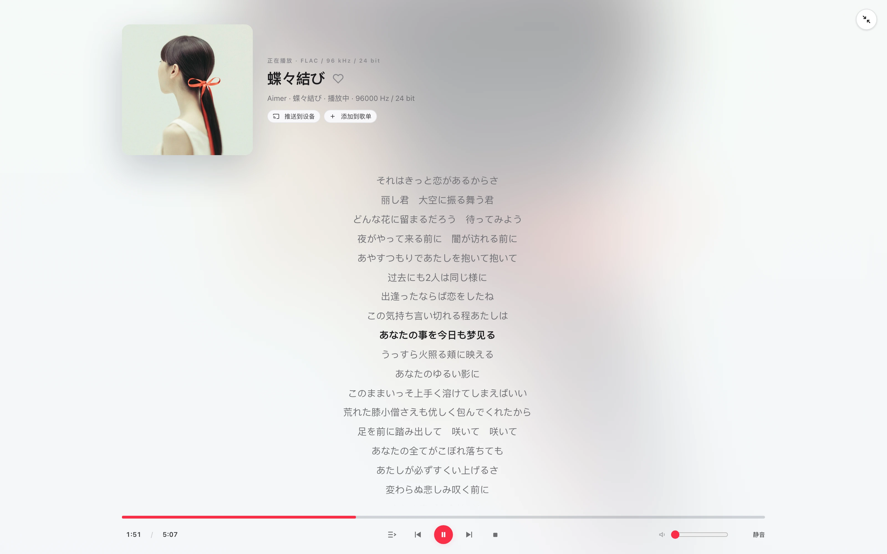
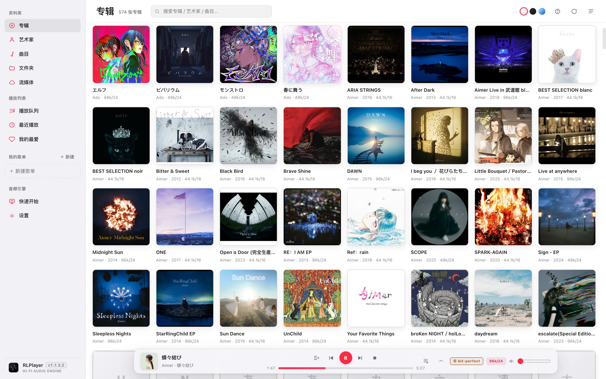
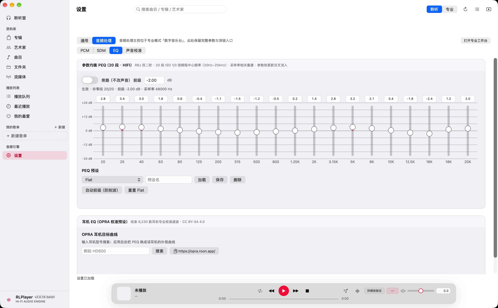
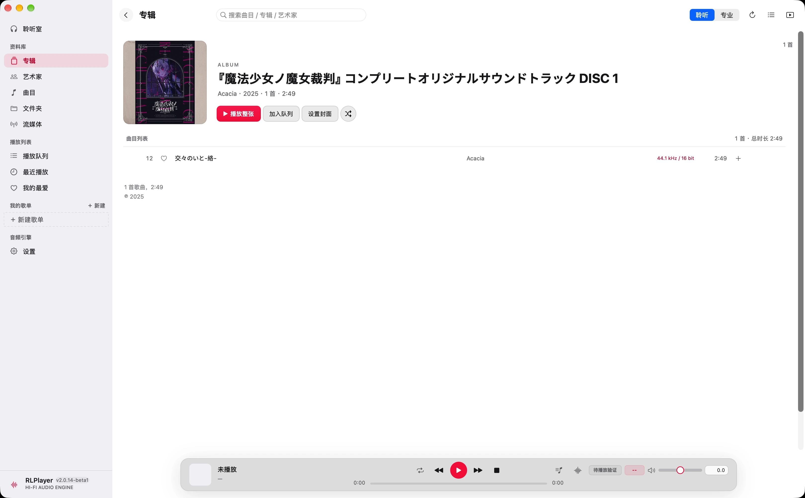

<p align="center">
  <a href="README.md"></a>
  <a href="README.zh-CN.md"></a>
</p>

<h1 align="center">RLPlayer for macOS</h1>

<p align="center">
  <b>Native Apple Silicon HiFi Playback Engine · Bit-Perfect CoreAudio Hog · In-House DSP · SDM/DSD · 20-Band PEQ</b>
</p>

<p align="center">
  
  <a href="https://github.com/BH2VOQ/RLPlayer-Mac/releases"></a>
  
  
  
  
</p>

<p align="center">
  <sub>Current version: <b>v2.0.14-beta1</b> · <a href="https://github.com/BH2VOQ/RLPlayer-Mac/releases">Releases &amp; Changelog</a> · <a href="CONTRIBUTING.md">Contributing</a></sub>
</p>

---

<p align="center">
  
</p>

| 52 | 4 | 6,230 | 251 | 0 |
| :---: | :---: | :---: | :---: | :---: |
| Upsampling Presets | SDM Modulator Families | OPRA Headphone Curves | `ctest` Test Cases | Runtime Dependencies |

---

## Why RLPlayer? (Core Advantages)

RLPlayer for macOS is built from the ground up as a **measurement-driven, native Apple Silicon HiFi engine**—not an Electron wrapper or a thin GUI around a third-party playback library.

### 1. 100% In-House DSP Chain — Numbers Over Guesswork
- **Polyphase Sinc Upsampling**: Arbitrary rational ratios across **52 named presets** (Kaiser / Gaussian / Blackman-Harris windows, linear / minimum / mixed phase, tight variants), achieving **−189.10 dB** stopband attenuation and **0.0000 dB** passband ripple.
- **Dither & Noise Shaping**: `NS1` / `NS4` / `NS5` / `NS9` / `LNS15` paired with `RPDF` / `TPDF` / `Gauss1` / `Shaped`. At 44.1 kHz → 705.6 kHz, `NS9` delivers **3.5 → 86.5 dB** in-band SNR gain over TPDF.
- **SDM / DSD Modulation**: Four modulator families—Butterworth (`DSD5` / `DSD7`), 7th-order Chebyshev, EC error-feedback, and AHM multi-level. `EC-5` reaches **113.5 dB** in-band SNR at DSD256 (`AHM-8bit` reaches **131.6 dB**).
- **Zero-Latency Partitioned Convolution**: Uniformly partitioned FFT convolution with **≤ 6.1e-14** relative error against direct convolution.
- **20-Band Parametric EQ & Overload Protection**: ISO 1/3-octave RBJ biquads (±24 dB range, draggable curve nodes with 0 px lag, `⌥ Option` fine frequency sweep), automatic preamp anti-clipping, and oversampled inter-sample peak (ISP) protection.

### 2. Engineered for Apple Silicon (`arm64`)
- **NEON SIMD & Persistent DSP Thread Pool**: Resampling and core DSP stages are accelerated with ARM NEON SIMD instructions and backed by a persistent multi-core DSP thread pool to eliminate per-track thread spin-up jitter.
- **Dynamic Metal GPU Acceleration**: `librtagpu.dylib` compiles MSL kernels at runtime—boosting 44.1k → 352.8k upsampling by **29×** (and 44.1k → 384k by **5.5×**). Based on real M-series benchmarks, GPU convolution is kept off by default because CPU FFT outperforms GPU at 4,096-sample production block sizes.
- **Zero External Runtime Dependencies**: Distributed as a standalone `.app` bundle with LGPL FFmpeg/FFprobe 8.1.2 and Metal kernels built in.

### 3. True Bit-Perfect Hardware Control on macOS
- **CoreAudio Exclusive (Hog Mode, On by Default)**: Uses AUHAL + Hog preemption + **physical format lock** (`kAudioStreamPropertyPhysicalFormat`, read back and verified) to bypass the system mixer. On conflict, it reports the real `DeviceBusy` status and blocking PID instead of misleading format errors.
- **Honest Status Reporting (6-State Bit-Perfect Badge)**: Separately tracks Passthrough, PCM→PCM, PCM→DSD, and DSD→DSD bit-perfect status and explicitly states the exact downgrade reason whenever a path is not bit-perfect (e.g., `float32`-only endpoints or shared mode).
- **DoP & Network Casting**:
  - **DoP**: 24-bit carrier encapsulation for DSD on macOS, never silently falling back to shared mode.
  - **UPnP / DLNA**: SSDP discovery, AVTransport control, renderer capability alignment, and byte-identical local file serving.
  - **AirPlay (Cast to Device)**: Direct plaintext AirPlay 1 / RAOP receiver discovery (`ALAC 44.1 kHz / 16 bit / stereo`) with clock sync, bounded packet retransmission, and explicit conversion disclosure.

### 4. Native Shell, Fast Library & Audio Health Check
- **Single-Process Native Shell**: `NSWindow + WKWebView` with AppKit refinements and a custom `rlplayer://app/` scheme—**the main process opens no listening TCP port** during local playback. Instant window-hide and bounded shutdown (< 2.5 s) prevent close stalls while playing.
- **60×–250× Faster Tag Parsing**: Native FLAC / WAV / MP3 / OGG metadata parsers bypass `ffprobe` subprocess overhead; full CUE sheet splitting supports UTF-16 / UTF-8 / GBK and 1/75-frame indices.
- **6,230 OPRA Headphone Curves & Track Health Check**: One-click OPRA headphone target EQ loading, plus `/api/track/health` objective diagnostics (THD+N, noise floor, stereo correlation, mono compatibility, side/mid ratio, and 4× oversampled true peak dBTP).
- **6-Source Metadata Enrichment & AI Integration**: QQ Music, NetEase Cloud Music, iTunes, lrclib, dizzylab, and Discogs with user-orderable priority, plus OpenAI-compatible AI enrichment (DeepSeek, OpenAI, OpenRouter, SiliconFlow, local Ollama, or custom gateways).

---

## Signal Chain in One Minute

```text
FLAC 44.1 kHz / 16 bit
  → poly-sinc-gauss-long   ·  linear phase · 65535 taps
  → LNS15                  ·  noise shaping
  → EC-5                   ·  DSD256 modulator
  → DoP 11.2896 MHz        ·  24-bit carrier
  → CoreAudio Hog Mode     ·  physical format locked
```

Every stage above is live-inspected and verifiable in `/api/signal` and `rlplayer-playback.log`.

---

## Interface Previews

<table>
  <tr>
    <td width="50%"></td>
    <td width="50%"></td>
  </tr>
  <tr>
    <td><b>Library &amp; Playback</b> — Album grid, Subsonic streaming integration, CUE track splitting, and live signal-chain status.</td>
    <td><b>DSP &amp; Calibration</b> — Upsampling filters, SDM modulators, 20-band PEQ with draggable nodes, and 6,230 OPRA headphone curves.</td>
  </tr>
</table>

<details>
<summary><b>More UI Previews (Album Detail)</b></summary>
<p align="center">
  
</p>
</details>

### Keyboard Shortcuts

| Key | Action |
| --- | --- |
| `Space` | Play / pause |
| `←` / `→` | Previous / next track |
| `Shift` + `←` / `→` | Seek back / forward 5 s |
| `↑` / `↓` | Volume ±0.5 dB (hold `Shift` for ±0.1 dB) |
| `N` / `P` / `S` | Next / previous / stop |
| `L` | Lyrics view |
| `I` | Signal chain |
| `⌘` + `F` | Search |
| `Esc` | Go back one level |

---

## Installation

1. Download `RLPlayer-<version>-macOS-arm64.dmg` from [Releases](https://github.com/BH2VOQ/RLPlayer-Mac/releases).
2. Double-click to mount and drag `RLPlayer` into `Applications`.
3. On first launch, if macOS warns that the developer cannot be verified: right-click → **Open**, or go to **System Settings → Privacy & Security → Open Anyway**.

> The binary is ad-hoc signed and not notarized by Apple, which is sufficient for personal and internal use.

### System Requirements

| Item | Requirement |
| --- | --- |
| OS | macOS 13.0 or later |
| Architecture | Apple Silicon (`arm64` only; Intel Macs are not supported) |
| Dependencies | None (FFmpeg / FFprobe and Metal kernels are bundled inside `.app`) |

---

## Build from Source & Testing

```bash
# Prerequisites: CMake ≥ 3.20, Xcode Command Line Tools
cmake -S . -B build-mac -DCMAKE_BUILD_TYPE=Release
cmake --build build-mac -j8
ctest --test-dir build-mac --output-on-failure     # 251 test cases

# Package .app (enforces architecture, deployment target, and signing gates)
bash tools/make_app_mac.sh
# → dist-mac/RLPlayer.app
```

Verification **does not open audio hardware by default**: offline analysis and the Null backend run first, and any audible test runs at ≤ −60 dBFS.

---

## Objective Measurements

Measured on Apple M4 / macOS:

| Metric | Measured Result |
| --- | --- |
| Upsampling stopband attenuation (44.1k → 384k) | **−189.10 dB** |
| Upsampling passband ripple | **0.0000 dB** |
| Upsampling worst harmonic | **−134.54 dBc** |
| DSD source decimation THD+N (DSD64 → 176.4k) | **99.37 dB** |
| EC-5 in-band SNR (DSD256) | **113.5 dB** |
| AHM-8bit in-band SNR (DSD256) | **131.6 dB** |
| 20-band PEQ, single band at +6 dB | **6.0000 dB** |
| Partitioned FFT convolution vs direct convolution | relative error **≤ 6.1e-14** |
| CoreAudio shared path bit-for-bit comparison | 16/24/32-bit all **0 LSB** |
| UPnP served byte count | **byte-identical to source** |

---

## Known Limitations

- **Native DSD is unavailable on macOS**: CoreAudio defines PCM only; `dsdnative=1` explicitly returns an error instead of silently downgrading. DSD output uses DoP.
- **Bit-perfect requires a lockable integer physical format**: Endpoints whose physical layer offers only `float32` (built-in speakers, virtual devices) cannot pass integer samples bit-for-bit and are marked accordingly.
- **AirPlay compatibility**: Direct casting targets plaintext AirPlay 1 / RAOP receivers (`44.1 kHz / 16 bit / stereo` ALAC); AirPlay 2 multi-room, password auth, and encrypted-only receivers are not supported.
- **UPnP casting and CUE tracks**: UPnP renderers stream discrete files; clicking a CUE-split track while casting reports an explicit error.
- **GPU upsampling precision**: Apple GPUs lack double precision, so the Metal upsampling path uses float32 (difference from CPU is ~−132.6 dB).
- **Apple Silicon only**: `x86_64` builds are rejected.

---

## Documentation & Project Origin

- [GPU precision measurements](<docs/GPU精度实测.md>) · [GPU efficiency tests](<docs/GPU卷积与升频效率细查.md>)
- [CONTRIBUTING.md](CONTRIBUTING.md) · [SECURITY.md](SECURITY.md) · [CODE_OF_CONDUCT.md](CODE_OF_CONDUCT.md)

This repository is an **independent macOS branch of RLPlayer** derived from upstream [okhuoyanyan/RLPlayer2](https://github.com/okhuoyanyan/RLPlayer2) (Windows edition), with its platform audio, GPU, and UI shell rewritten natively for macOS.

---

## License

Released under **GNU General Public License v3.0 or later** (`GPL-3.0-or-later`). See [LICENSE](LICENSE), [COPYRIGHT.md](COPYRIGHT.md), and [OPRA-NOTICE.txt](OPRA-NOTICE.txt).

- FFmpeg / FFprobe 8.1.2 (`LGPL-2.1-or-later`) and LAME (`LGPL-2.0-or-later`) are distributed as standalone subprocess executables inside the bundle (not linked into the main binary).
- OPRA headphone EQ data is licensed under `CC BY-SA 4.0`.

<p align="center">
  <sub><b>English</b> (current) · <a href="README.zh-CN.md">简体中文</a></sub>
</p>
