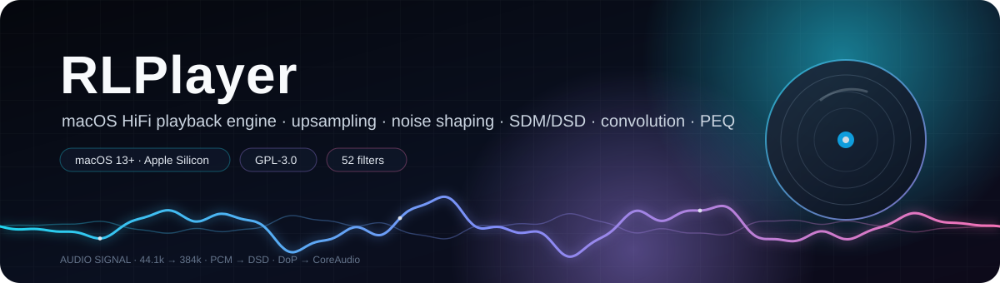

<p align="center">
  <a href="README.md"></a>
  <a href="README.zh-CN.md"></a>
</p>

<p align="center">
  <picture>
    <source media="(prefers-color-scheme: dark)" srcset="docs/images/hero-en.svg">
    <source media="(prefers-color-scheme: light)" srcset="docs/images/hero-en-light.svg">
    
  </picture>
</p>

<p align="center">
  
  <a href="https://github.com/BH2VOQ/RLPlayer-Mac/releases"></a>
  
  
  
  
</p>

<p align="center">
  <b>HiFi signal chain · upsampling · noise shaping · SDM/DSD · convolution · 20-band PEQ</b>

  <sub>Every step comes with a reproducible measurement, not “I think it sounds better”.</sub>

  <sub>Current version follows the Release badge above · <a href="ROADMAP-1.1.x.md">Roadmap</a> · <a href="https://github.com/BH2VOQ/RLPlayer-Mac/releases">Changelog</a></sub>
</p>

---

<p align="center">
  
</p>

|  52  |     4    |    6230   |    100   |   0   |
| :--: | :------: | :-------: | :------: | :---: |
| Upsampling presets | SDM modulator families | OPRA headphone curves | ctest cases | Runtime dependencies |

## Why RLPlayer

- **The whole chain is in-house, not a player shell.** Upsampling, dither/noise shaping, SDM/DSD modulation, convolution and the 20-band PEQ are this repository's own DSP code; every module has numeric criteria — “it makes a sound” is not a pass.
- **Numbers, not opinions.** Upsampling stopband **−189.1 dB**, DSD decimation THD+N **99.37 dB**, partitioned convolution error **≤6.1e-14**, shared output at 16/24/32 bit all **0 LSB**. Full table under [Objective measurements](#objective-measurements).
- **Native macOS.** A single-process `.app` (NSWindow + WKWebView), CoreAudio Hog, Metal acceleration (upsampling on by default, convolution off by default based on measurements), native arm64, ffmpeg/ffprobe bundled; no runtime dependencies to install.

## Signal chain in one minute

```text
FLAC 44.1 kHz / 16 bit
  → poly-sinc-gauss-long   ·  linear phase · 65535 taps
  → LNS15                  ·  noise shaping
  → EC-5                   ·  DSD256 modulator
  → DoP 11.2896 MHz        ·  24-bit carrier
  → CoreAudio Hog Mode     ·  physical format locked
```

This chain is not an illustration: every item is visible with the actual values of the current playback in `/api/signal` and `rlplayer-playback.log`.

---

## Features

### 🎛 Signal chain

- **Polyphase sinc upsampling** — arbitrary rational ratios, **52 named presets**; measured stopband **−189.1 dB**, passband ripple **0.0000 dB**
- **Filter families** — Kaiser / Gaussian / Blackman-Harris windows, linear / minimum / mixed phase, tight variants; taps and cutoff adjustable
- **Dither and noise shaping** — NS1/NS4/NS5/NS9/LNS15 + RPDF/TPDF/Gauss1/Shaped; NS9's in-band gain over TPDF is **3.5→86.5 dB** going from 44.1k to 705.6k
- **SDM modulators** — four families: Butterworth (DSD5/DSD7), 7th-order Chebyshev, EC error feedback, AHM multi-level; EC-5 reaches **113.5 dB** in-band SNR at DSD256
- **Native DSD reading** — DSF/DFF parsed directly, without ffmpeg; DirectSDM passes through bit-for-bit at matching rates; large files are streamed in chunks (1764000 frames, sample-exact)
- **Convolution engine** — zero-latency uniformly partitioned FFT; relative error against direct convolution **≤6.1e-14**
- **20-band PEQ** — RBJ biquads, 20 center frequencies on the ISO 1/3-octave grid, draggable nodes, automatic preamp anti-clipping; a single band at +6 dB measures **6.0000 dB** (44.1/48/96/192 kHz)
- **Overload protection** — oversampled peak detection (ISP) with automatic pre-attenuation, volume ramping, DoP volume locked at 0 dB; full-scale / transient / recovery each have regression coverage

### 🔊 Output

- **CoreAudio exclusive (Hog)** — AUHAL + Hog preemption + physical format lock, avoiding resampling by the system mixer; when a device does not support the target format it **reports the error honestly instead of substituting silently**
- **CoreAudio shared** — the fallback when exclusive mode is unavailable; `bit_perfect()` explicitly returns false and says so; 16/24/32-bit measured deviation **0 LSB**
- **DoP** — DSD wrapped in a 24-bit carrier, the only DSD output path on macOS; in DoP mode it never silently falls back to shared
- **UPnP / DLNA** — real SSDP discovery + AVTransport control + local serving; the served byte count is **byte-identical to the file**
- **Null** — runs the DSP without opening a device; all offline tests and automated checks go through it
- **Three official presets** — bit-perfect passthrough / PCM upsampling / DSD upsampling (the backend also supports a fourth, PCM→DSD); the recommended preset is computed live from the current device's capabilities, with the downgrade reason stated

### 🖥 Interface

- **Single-process native shell** — NSWindow + WKWebView, pages served through a custom `rlplayer://app/` scheme to the in-process core, **the main process listens on no port** (only a temporary local serving service while casting over UPnP)
- **Three palettes × two UI styles** — dark / white / light blue, in an Apple Music style and a classic Hi-Fi workstation style
- **Ten settings tabs** — Input / Output / PCM / SDM / Advanced / EQ / Sound calibration / Metadata / Streaming / Diagnostics; the tab bar is fixed and only the content scrolls
- **Six-state bit-perfect badge** — passthrough, PCM→PCM, PCM→DSD and DSD→DSD each distinguish whether they are bit-perfect, with the downgrade reason
- **Full-bleed window** — hidden title bar + FullSizeContentView with content filling the window, and 5 px hot zones on all four edges for resizing

### 📚 Library and tools

- **Native tag parsing** — FLAC / WAV / MP3 / OGG read directly, **60×–250× faster** than going through ffprobe
- **CUE sheet splitting** — UTF-16 / UTF-8 / GBK encodings and 1/75-frame indices
- **Metadata enrichment** — five sources: QQ Music / NetEase Cloud Music / iTunes / lrclib / dizzylab; tags, cover art and lyrics are filled in automatically during playback
- **Online cover fetching** — embedded art → web art → 7-day negative cache; no negative caching while offline, and a miss is recorded only when the server explicitly says there is none
- **OPRA headphone EQ** — **6230** headphone target curves built in, written into the EQ chain in one click
- **Audio health check** — `/api/track/health` plus a per-track popup, 19 objective metrics; the `rtahealth` CLI runs the same algorithms offline
- **Auto-update** — check, download, sha256 verification, install, rollback on failure; the channel is a public GitHub repository and the client holds no token
- **Built-in feedback** — Settings → Diagnostics, describe the issue, optionally attach a diagnostic bundle (already redacted), forwarded through a Cloudflare Worker; the `.zip` can also be exported and sent manually

---

## Interface

<table>
  <tr>
    <td width="50%"></td>
    <td width="50%"></td>
  </tr>
  <tr>
    <td><b>Quick start</b> — three capability cards + three official presets, with the recommended preset computed live from the current device's capabilities.</td>
    <td><b>Album detail</b> — the full album track list; each row can be favorited or queued on its own, and the whole album plays from the top.</td>
  </tr>
</table>

<details>

<summary><b>More screenshots (artists / tracks / output / EQ)</b></summary>

<table>
  <tr>
    <td width="50%"></td>
    <td width="50%"></td>
  </tr>
  <tr>
    <td><b>Artists</b> — circular cover grid, with the album count on each card.</td>
    <td><b>Tracks</b> — a flat list of the whole library, sort order selectable at the top right, and “+” on the right queues a single track.</td>
  </tr>
  <tr>
    <td></td>
    <td></td>
  </tr>
  <tr>
    <td><b>Settings · Output</b> — Hog mode toggled in one click; sample rate and bit depth follow the device negotiation, and failures are reported.</td>
    <td><b>Settings · EQ</b> — 20 draggable band nodes, automatic preamp anti-clipping, presets can be saved.</td>
  </tr>
</table>

</details>

### Keyboard shortcuts

| Key                   | Action                                         |
| --------------------- | ---------------------------------------------- |
| `Space`               | Play / pause                                   |
| `←` / `→`             | Previous / next track                          |
| `Shift` + `←` / `→`   | Seek back / forward 5 s                        |
| `↑` / `↓`             | Volume ±0.5 dB (hold `Shift` for ±0.1 dB)      |
| `N` / `P` / `S`       | Next / previous / stop                         |
| `L`                   | Lyrics page                                    |
| `I`                   | Signal chain                                   |
| `⌘` + `F`             | Search                                         |
| `Esc`                 | Go back one level                              |

---

## Install

1. Download `RLPlayer-<version>-macOS-arm64.dmg` from [Releases](https://github.com/BH2VOQ/RLPlayer-Mac/releases)
2. Double-click to mount, then drag `RLPlayer` into Applications
3. If the first launch says the developer cannot be verified: right-click → Open, or go to System Settings → Privacy & Security → Open Anyway

The app is ad-hoc signed and not notarized by Apple. That is fine for personal use and internal distribution; for public distribution, Developer ID signing plus notarization is recommended.

### System requirements

| Item         | Requirement                                                        |
| ------------ | ------------------------------------------------------------------ |
| OS           | macOS 13.0 or later                                                |
| Chip         | Apple Silicon (arm64); **arm64 only**, Intel Macs are not supported |
| Dependencies | None. The `.app` bundles ffmpeg / ffprobe and the Metal kernel     |

---

## Build from source

```bash
# Prerequisites: CMake ≥ 3.20, Xcode Command Line Tools
cmake -S . -B build-mac -DCMAKE_BUILD_TYPE=Release
cmake --build build-mac -j8
ctest --test-dir build-mac --output-on-failure     # 100/100

# Build the .app (the script gates architecture / deployment target / signing, and fails if any check is off)
bash tools/make_app_mac.sh
# → dist-mac/RLPlayer.app
```

> If CMake lives inside `CMake.app` on your machine, just call it by full path; the gate is the **exit code**, not the last line.

---

## Tests

```bash
ctest --test-dir build-mac --output-on-failure
```

**100/100 passing.** Covers DSP numerics, output paths, networking, metadata, the UI decision layer and the update installer logic.

Verification **does not open audio devices by default**: offline analysis and the Null backend come first; every test that has to make sound runs at ≤ −60 dBFS.

Some figures are not in ctest (the GPU performance table, the full GPU precision matrix, room correction and health-check values); those are run manually through probes such as `gpu_precision` and recorded under `docs/`.

---

## Objective measurements

Every number below is measured on this machine (Apple M4 / macOS 27.0.1), not estimated.

| Item                                                        | Measured                        |
| ----------------------------------------------------------- | ------------------------------- |
| Upsampling stopband attenuation (44.1k → 384k)              | **−189.10 dB**                  |
| Upsampling passband ripple                                  | **0.0000 dB**                   |
| Upsampling worst harmonic                                   | **−134.54 dBc**                 |
| DSD source decimation THD+N (DSD64 → 176.4k)                | **99.37 dB**                    |
| EC-5 in-band SNR (DSD256)                                   | **113.5 dB**                    |
| AHM-8bit in-band SNR (DSD256)                               | **131.6 dB**                    |
| 20-band PEQ, single band at +6 dB                           | **6.0000 dB**                   |
| Partitioned FFT convolution vs direct convolution           | relative error **≤6.1e-14**     |
| CoreAudio shared path, bit-for-bit comparison               | 16/24/32 bit all **0 LSB**      |
| UPnP served byte count                                      | **byte-identical to the file**  |

---

## GPU

<details>

<summary><b>Metal kernels: upsampling is worth enabling, convolution is off by default (click for measurements)</b></summary>

The Metal kernel (`librtagpu.dylib`, MSL compiled at runtime) is **loaded dynamically**: if `dlopen` fails it falls back to CPU without losing functionality.

- **Upsampling: worth enabling** — 44.1k → 352.8k is **29×** faster, 44.1k → 384k is **5.5×** faster
- **Convolution: off by default** — a production block holds only 4096 samples, far below the GPU break-even point (measured: it needs n ≥ 32768 to win), so it is slower than CPU at any IR length: **2.15×–3.57×** measured per block (n=4096, block=1024); **3.4×–8.3×** when measured against the real overlap-save input volume

The functionality stays available and numerically correct (worst convolution case **−126.5 dB** relative RMS), but enabling it on the Mac is a net loss. The UI already marks it as not recommended. Full measurements for both accounting conventions are in [GPU precision](<docs/GPU精度实测.md>) and [docs/GPU卷积与升频效率细查.md](<docs/GPU卷积与升频效率细查.md>).

</details>

---

## 🗺 Roadmap

> **1.1.0** is the baseline for this roadmap; the actual released version follows the Release badge above. 1.1.1 onward is planned and **not started**; the full criteria, split lines and open items are in
> **[ROADMAP-1.1.x.md](ROADMAP-1.1.x.md)**.

| Version   | Theme                                                              | Status     |
| --------- | ------------------------------------------------------------------ | ---------- |
| **1.1.0** | Baseline release                                                   | ✅ Released |
| **1.1.1** | Finer diagnostics + debug backlog cleanup                          | 🧭 Planned  |
| **1.1.2** | **AirPlay output support**                                         | 🧭 Planned  |
| **1.1.3** | LLM model list                                                     | 🧭 Planned  |
| **1.1.4** | Audio analysis on the track page (three-level folding / true peak / multichannel) | 🧭 Planned |
| **1.1.5** | Library lookup (album context / asynchronous knowledge)            | 🧭 Planned  |
| **1.1.6** | AI summary streaming and stage progress                            | 🧭 Planned  |
| **1.1.7** | Batch cover backfill (resume / per-source stats / silhouette rejection) | 🧭 Planned |
| **1.1.8** | Safe cover write-back (off by default)                             | 🧭 Planned  |
| **1.1.9** | macOS platform and performance (QoS / App Nap / caching / benchmarks) | 🧭 Planned |
| **1.2.0** | Room measurement wizard (real-machine acceptance)                  | 🧭 Planned  |


**Release discipline**: every version starts with `-beta1`; during beta only bug fixes go in; a stable release ships only when P0/P1 are at zero. Version numbers are not reserved, and 1.2.0 is the ceiling.

---

## Known limitations

- **Native DSD is unavailable** — CoreAudio defines PCM only and has no native DSD path; `dsdnative=1` reports an explicit error instead of silently downgrading. DSD works only through DoP
- **AirPlay is not supported yet** — planned for **1.1.2**; the device list does not currently distinguish AirPlay from local sound cards, so choosing AirPlay does not mean it has been verified
- **The room measurement wizard is currently hidden** — 7 transport-layer defects are fixed; the wizard and real microphone measurement are planned for **1.2.0**; the existing manual “EQ file / room correction IR” loading still works
- **Hog is not exclusive kernel audio** — Hog takes over the device but does not block I/O from other processes; the real bit-perfect guarantee comes from the physical format lock
- **The exclusive path cannot prove itself bit-for-bit** — a device-side loopback tap conflicts with Hog, so the exclusive path currently has only indirect evidence
- **GPU convolution is slower in production shape** — see the previous section
- **GPU upsampling is not bit-exact** — Apple GPUs have no double precision, so it uses the float path; the difference from CPU is on the order of −132.6 dB
- **7th-order 1-bit modulators** — automatically drop to 5th order below DSD128; the Chebyshev family always uses 5th order
- **Fake-lossless detection** — AAC ≥128k is not detected; the design tradeoff is “rather miss it than flag it falsely”
- **Input capture does not go through the DSP** — capture and monitoring are implemented, but monitor is a direct passthrough; the capture → DSP chain is not wired
- **Intel Macs are not supported** — only arm64 is built; passing `x86_64` fails with a hard FATAL

See the [development roadmap](ROADMAP-1.1.x.md) for unfinished features and acceptance criteria; historical test numbers apply only to the environment and version recorded in the report, and do not represent a re-measurement in this round.

---

## Documentation

| File | Contents |
|---|---|
| [ROADMAP-1.1.x.md](ROADMAP-1.1.x.md) | **Roadmap after 1.1.0**: per-version tasks, criteria, dependencies and split lines |
| [GPU precision measurements](<docs/GPU精度实测.md>) | Metal numeric precision, re-run commands and untested boundaries |
| [GPU efficiency tests](<docs/GPU卷积与升频效率细查.md>) | Performance data at specific block sizes and its limits; the standalone probe re-run commands are not fully archived |
| [CONTRIBUTING.md](CONTRIBUTING.md) | Contribution guide: build, gates, commit conventions, what is not accepted |
| [SECURITY.md](SECURITY.md) | Private security reporting channel and known design boundaries |
| [CODE_OF_CONDUCT.md](CODE_OF_CONDUCT.md) | Code of conduct |

---

## Project origin

This repository is an **independent macOS branch of RLPlayer**: the platform layer (audio output, GPU, window shell) has been rewritten against native macOS capabilities and **no longer merges with upstream**; version numbers start independently from `1.0.0`, and the current version follows the Release badge above (this roadmap baseline is 1.1.0).

Upstream repository (Windows edition): **<https://github.com/okhuoyanyan/RLPlayer2>**

This document describes only the actual capabilities of the macOS branch and does not cover other platform editions.

---

## Contributing

- Build, gates and commit conventions: [CONTRIBUTING.md](CONTRIBUTING.md)
- For security issues, please **do not** open a public issue; see [SECURITY.md](SECURITY.md)
- For feedback, prefer the in-app **Settings → Diagnostics → Send feedback** (optionally with a diagnostic bundle), or open an [issue](https://github.com/BH2VOQ/RLPlayer-Mac/issues)

> There is only one acceptance rule: **every step must come with a reproducible measurement**. Conclusions like “I think it sounds better” are not accepted.

---

## License

This project is released under the **GNU General Public License, version 3 or later**, SPDX identifier `GPL-3.0-or-later`.

Copyright (C) 2026 August Hu

- Full terms in [LICENSE](LICENSE) at the repository root (official GPLv3 text, unmodified)
- Every source file carries an `SPDX-License-Identifier: GPL-3.0-or-later` header
- Binary distributions ship `LICENSE` and `OPRA-NOTICE.txt` inside `Contents/Resources/`

In short: you may use, modify and redistribute this program freely, but **any redistribution must also be open source under GPLv3** and must keep the copyright and license notices. The program comes with no warranty.

<details>
<summary><b>Third-party components and licenses</b></summary>

| Component | License | Relationship to this program |
|---|---|---|
| FFmpeg / FFprobe 8.1.2 | LGPL-2.1-or-later | Distributed as **standalone executables** inside the bundle and invoked by the main program as subprocesses; the build does not enable `--enable-gpl`, so this is the LGPL build. `otool -L` confirms the main program **links no** libav* library |
| LAME (libmp3lame) | LGPL-2.0-or-later | Statically linked into that FFmpeg executable, not into the main program. `third_party/lame-arm64/COPYING` is the full GNU Library GPL v2 text, and `lame.h` says “either version 2 … or any later version”, hence 2.0-or-later |
| OPRA headphone EQ data | CC BY-SA 4.0 | Attribution and share-alike scope in [OPRA-NOTICE.txt](OPRA-NOTICE.txt); it covers the data only and does not propagate to this program's source |

Because FFmpeg runs as a separate process rather than a linked library, the GPLv3 of this project and its LGPL obligations toward FFmpeg do not conflict; replacing `Contents/MacOS/ffmpeg` with any compatible build satisfies the LGPL replaceability (relinking) requirement.

</details>

---

<p align="center">
  <sub><b>English</b> (current) · <a href="README.zh-CN.md">简体中文</a></sub>
</p>

<p align="center">
  <sub>If RLPlayer has been useful to you, a <a href="https://github.com/BH2VOQ/RLPlayer-Mac">Star on GitHub</a> is welcome and supports further development.</sub>
</p>
