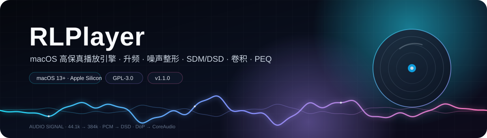
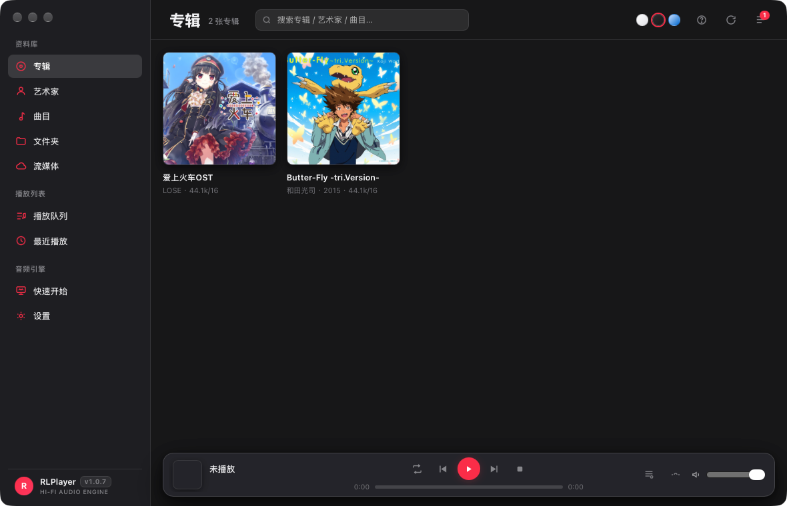
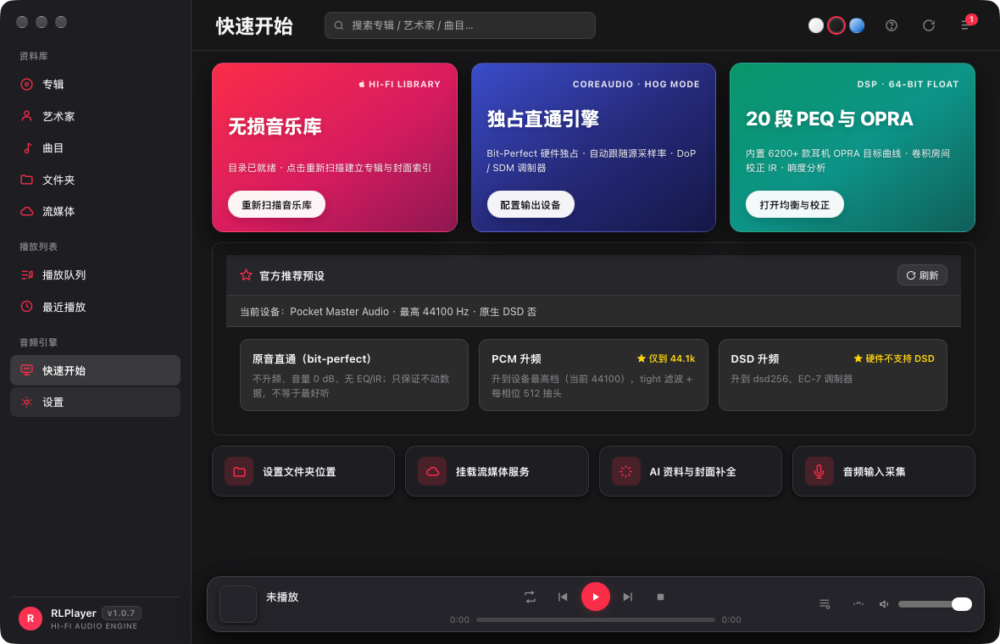
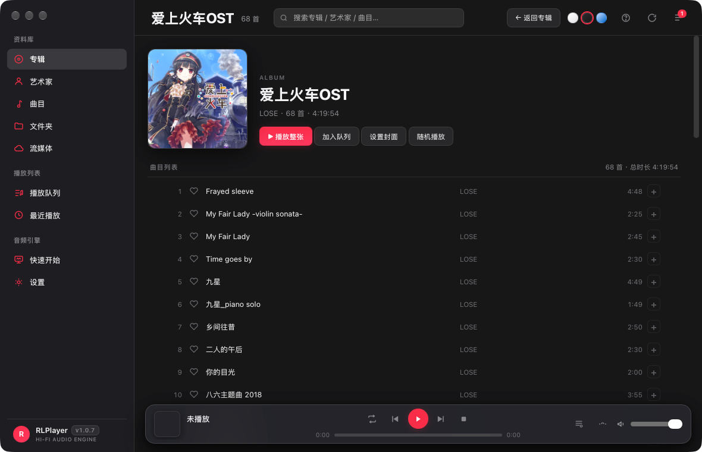
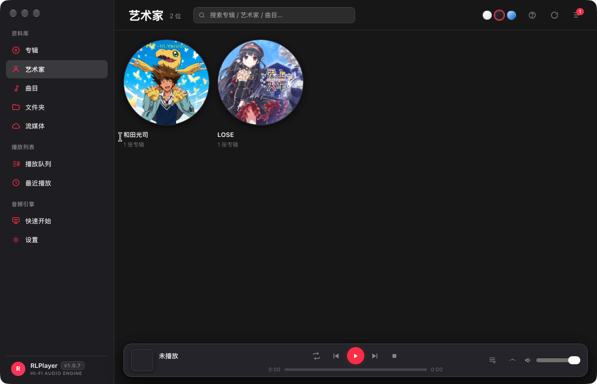
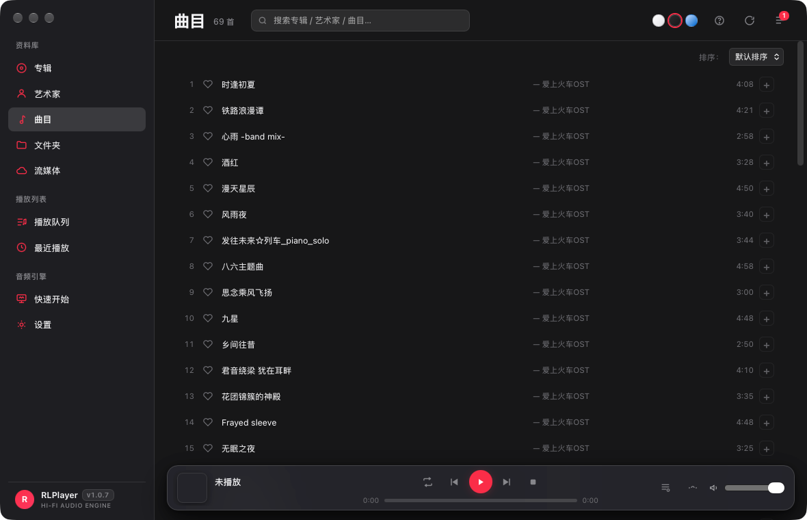
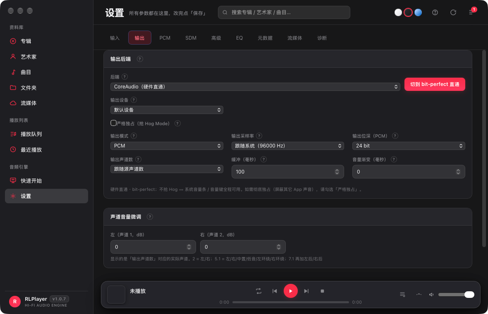
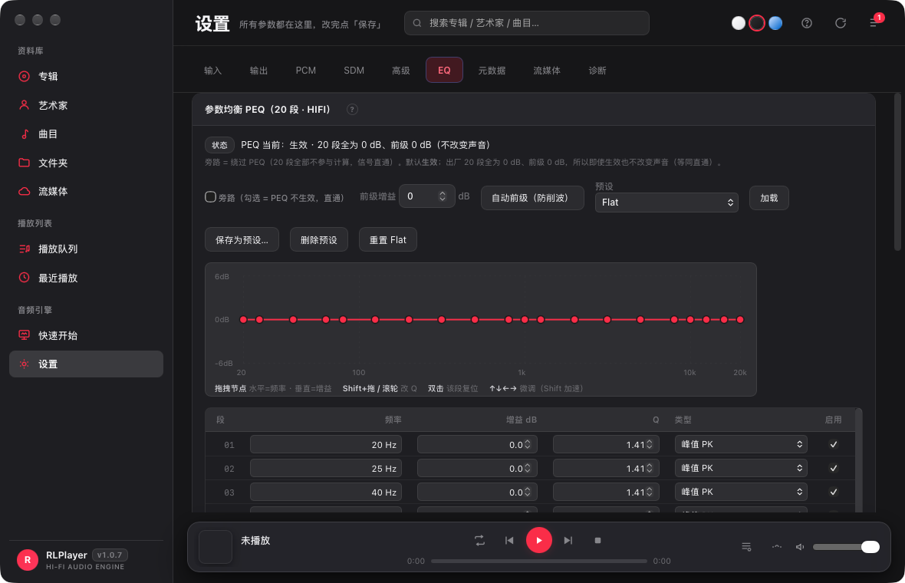
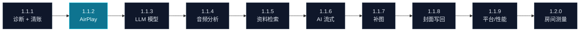

<p align="center">
  <a href="README.md"></a>
  <a href="README.zh-CN.md"></a>
</p>

<p align="center">  
  <picture>  
    <source media="(prefers-color-scheme: dark)" srcset="docs/images/hero.svg">  
    <source media="(prefers-color-scheme: light)" srcset="docs/images/hero-light.svg">  
      
  </picture>  
</p>

<p align="center">  
    
  <a href="https://github.com/BH2VOQ/RLPlayer-Mac/releases"></a>  
    
    
    
    
</p>

<p align="center">  
  <b>HiFi 信号链 · 升频 · 噪声整形 · SDM/DSD · 卷积 · 20 段 PEQ</b>  
  
  <sub>每一步都给出可复现的实测数字，而不是「我觉得更好听」。</sub>  
  
  <sub>当前版本以上方 Release 徽标为准 · <a href="ROADMAP-1.1.x.md">路线图</a> · <a href="https://github.com/BH2VOQ/RLPlayer-Mac/releases">更新日志</a></sub>  
</p>

---

<p align="center">  
    
</p>

|  52  |     4    |    6230   |    100   |   0   |
| :--: | :------: | :-------: | :------: | :---: |
| 升频预设 | SDM 调制器族 | OPRA 耳机曲线 | ctest 用例 | 运行时依赖 |

## 为什么是 RLPlayer

- **全链路自研，不是播放器壳。** 升频、抖动/噪声整形、SDM/DSD 调制、卷积、20 段 PEQ 都是本仓库自己的 DSP 代码；每个模块都有数值判据，不是「能响就算过」。
- **数字说话。** 升频阻带 **−189.1 dB**、DSD 抽取 THD+N **99.37 dB**、分块卷积误差 **≤6.1e-14**、共享输出 16/24/32 bit 全部 **0 LSB**。完整表见 [客观指标](#客观指标)。
- **原生 macOS。** 单进程 `.app`（NSWindow + WKWebView）、CoreAudio Hog、Metal 加速（升频默认可用，卷积按实测默认关）、arm64 原生、包内自带 ffmpeg/ffprobe；不装任何运行时依赖。

## 一分钟看懂信号链

```text
FLAC 44.1 kHz / 16 bit
  → poly-sinc-gauss-long   ·  linear phase · 65535 taps
  → LNS15                  ·  noise shaping
  → EC-5                   ·  DSD256 modulator
  → DoP 11.2896 MHz        ·  24-bit carrier
  → CoreAudio Hog Mode     ·  physical format locked
```

这条链不是示意：每一项都能在 `/api/signal` 与 `rlplayer-playback.log` 里看到本次播放的实际值。

---

## 特性

### 🎛 信号链

- **多相 sinc 升频** — 任意有理比率，**52 个命名预设**；实测阻带 **−189.1 dB**、通带纹波 **0.0000 dB**
- **滤波器家族** — Kaiser / Gaussian / Blackman-Harris 三种窗，线性 / 最小 / 混合相位，tight 变体；抽头数与截止可调
- **抖动与噪声整形** — NS1/NS4/NS5/NS9/LNS15 + RPDF/TPDF/Gauss1/Shaped；NS9 相对 TPDF 的带内收益在 44.1k→705.6k 为 **3.5→86.5 dB**
- **SDM 调制器** — 四族：Butterworth（DSD5/DSD7）、7 阶 Chebyshev、EC 误差反馈、AHM 多电平；EC-5 在 DSD256 带内 SNR **113.5 dB**
- **DSD 原生读取** — DSF/DFF 直接解析，不经 ffmpeg；DirectSDM 同速率逐位直通，大文件分块流式解码（1764000 帧逐样本一致）
- **卷积引擎** — 零延迟均匀分块 FFT，分块结果与直接卷积相对误差 **≤6.1e-14**
- **20 段 PEQ** — RBJ 双二阶，20 个中心频率取自 ISO 1/3 倍频程网格，节点可拖、自动前级防削波；单段 +6 dB 实测 **6.0000 dB**（44.1/48/96/192 kHz）
- **过载保护** — 过采样峰值检测（ISP）自动预衰减、音量渐变、DoP 音量锁 0 dB；满幅 / 瞬态 / 恢复三段都有回归

### 🔊 输出

- **CoreAudio 独占（Hog）** — AUHAL + Hog 抢占 + 物理格式锁定，避免系统混音器重采样；设备不支持目标格式时**如实报错，不静默替换**
- **CoreAudio 共享** — 独占不可用时的兜底，`bit_perfect()` 明确返回 false 并告知；16/24/32 bit 三种位深实测 **0 LSB** 偏差
- **DoP** — 24-bit 载波封装 DSD，macOS 上唯一的 DSD 输出路径；DoP 模式下绝不静默回退到共享
- **UPnP / DLNA** — 真实 SSDP 发现 + AVTransport 控制 + 本地供源，实测供源字节数与文件**逐字节相同**
- **Null** — 只跑 DSP 不开设备，所有离线测试与自动化验证都走它
- **三档官方预设** — 原音直通 / PCM 升频 / DSD 升频（后端另支持第四档 PCM→DSD），按当前设备能力实时算出推荐档位并标注降级原因

### 🖥 界面

- **单进程原生壳** — NSWindow + WKWebView，页面走自定义 `rlplayer://app/` scheme 交给进程内核心，**主进程不监听端口**（只有 UPnP 投放期间临时起一个本地供源服务）
- **三套配色 × 两套界面风格** — 深色 / 白色 / 浅蓝色，Apple Music 风与经典 Hi-Fi 工作台各一套
- **十个设置页签** — 输入 / 输出 / PCM / SDM / 高级 / EQ / 声音校准 / 元数据 / 流媒体 / 诊断；页签条固定、只有内容滚动
- **六态位完美徽标** — 直通、PCM→PCM、PCM→DSD、DSD→DSD 各自区分是否 bit-perfect，并给出降级原因
- **通栏窗口** — 隐藏标题栏 + FullSizeContentView 内容铺满，四边 5px 热区可拉伸

### 📚 资料与工具

- **原生标签解析** — FLAC / WAV / MP3 / OGG 直接读，比走 ffprobe 快 **60×~250×**
- **CUE 整轨分轨** — UTF-16 / UTF-8 / GBK 编码与 1/75 帧索引
- **元数据补全** — QQ 音乐 / 网易云 / iTunes / lrclib / dizzylab 五源；播放时自动补标签、封面、歌词
- **在线封面抓取** — 内嵌图 → 网图 → 负缓存 7 天；断网不写负缓存，只有服务器明确说没有才记缺失
- **OPRA 耳机 EQ** — 内置 **6230** 款耳机目标曲线，一键写入 EQ 链
- **音质体检** — `/api/track/health` + 单曲页弹窗，19 项客观指标；`rtahealth` CLI 可离线跑同一套算法
- **自动更新** — 检查、下载、sha256 校验、安装、失败回滚；通道是公开的 GitHub 仓库，客户端零 token
- **内置反馈** — 设置 → 诊断里写问题描述，可选附诊断包（已脱敏），经 Cloudflare Worker 转发；也可导出 `.zip` 手动发送

---

## 界面

<table>  
  <tr>  
    <td width="50%"></td>  
    <td width="50%"></td>  
  </tr>  
  <tr>  
    <td><b>快速开始</b> — 三张能力卡片 + 三档官方预设，按当前设备能力实时算出推荐档位。</td>  
    <td><b>专辑详情</b> — 整轨曲目列表，每行可收藏、可单独入队，顶部直接播放整张。</td>  
  </tr>  
</table>

<details>

<summary><b>展开更多截图（艺术家 / 曲目 / 输出 / EQ）</b></summary>

<table>  
  <tr>  
    <td width="50%"></td>  
    <td width="50%"></td>  
  </tr>  
  <tr>  
    <td><b>艺术家</b> — 圆形封面网格，卡片上标注专辑数量。</td>  
    <td><b>曲目</b> — 全库扁平列表，右上角可选排序方式，右侧「+」单曲入队。</td>  
  </tr>  
  <tr>  
    <td></td>  
    <td></td>  
  </tr>  
  <tr>  
    <td><b>设置 · 输出</b> — Hog 模式一键切换，采样率与位深跟着设备协商，失败会报错。</td>  
    <td><b>设置 · EQ</b> — 20 段曲线节点可拖，自动前级防削波，可存预设。</td>  
  </tr>  
</table>

</details>

### 快捷键

| 键                   | 动作                               |
| ------------------- | -------------------------------- |
| `Space`             | 播放 / 暂停                          |
| `←` / `→`           | 上一首 / 下一首                        |
| `Shift` + `←` / `→` | 后退 / 前进 5 秒                      |
| `↑` / `↓`           | 音量 ±0.5 dB（按住 `Shift` 为 ±0.1 dB） |
| `N` / `P` / `S`     | 下一首 / 上一首 / 停止                   |
| `L`                 | 歌词页                              |
| `I`                 | 信号链                              |
| `⌘` + `F`           | 搜索                               |
| `Esc`               | 逐级返回                             |

---

## 安装

1. 到 [Releases](https://github.com/BH2VOQ/RLPlayer-Mac/releases) 下载 `RLPlayer-<版本>-macOS-arm64.dmg`
2. 双击挂载，把 `RLPlayer` 拖进「应用程序」
3. 首次打开若提示「无法验证开发者」：右键 →「打开」，或到 `系统设置 → 隐私与安全性 → 仍要打开`

ad-hoc 签名，未做 Apple 公证。自用与内部分发没有问题；正式对外分发建议走 Developer ID + 公证。

### 系统要求

| 项  | 要求                                              |
| -- | ----------------------------------------------- |
| 系统 | macOS 13.0 及以上                                  |
| 芯片 | Apple Silicon（arm64）**只支持 arm64**，不支持 Intel Mac |
| 依赖 | 无。`.app` 自带 ffmpeg / ffprobe 与 Metal 内核         |

---

## 从源码构建

```bash
# 前置：CMake ≥ 3.20、Xcode Command Line Tools
cmake -S . -B build-mac -DCMAKE_BUILD_TYPE=Release
cmake --build build-mac -j8
ctest --test-dir build-mac --output-on-failure     # 100/100

# 出 .app（脚本内做架构 / 部署目标 / 签名门禁，不达标直接失败）
bash tools/make_app_mac.sh
# → dist-mac/RLPlayer.app
```

> 本机若把 CMake 装在 `CMake.app` 里，用全路径调用即可；门禁看**退出码**，不要只看尾行。

---

## 测试

```bash
ctest --test-dir build-mac --output-on-failure
```

**100/100 通过。** 覆盖 DSP 数值、输出路径、网络、元数据、UI 判定层与更新安装逻辑。

验证默认**不打开音频设备**：优先离线分析与 Null 后端；需要出声的用例电平一律 ≤ −60 dBFS。

部分指标不在 ctest 里（GPU 性能表、GPU 精度全矩阵、房间校正与体检的具体数值），那些由 `gpu_precision` 等探针手动跑，结果记在 `docs/`。

---

## 客观指标

以下数字全部来自本机实测（Apple M4 / macOS 27.0.1），不是估算。

| 项                             | 实测                        |
| ----------------------------- | ------------------------- |
| 升频阻带衰减（44.1k → 384k）          | **−189.10 dB**            |
| 升频通带纹波                        | **0.0000 dB**             |
| 升频最大谐波                        | **−134.54 dBc**           |
| DSD 源抽取 THD+N（DSD64 → 176.4k） | **99.37 dB**              |
| EC-5 带内 SNR（DSD256）           | **113.5 dB**              |
| AHM-8bit 带内 SNR（DSD256）       | **131.6 dB**              |
| 20 段 PEQ 单段 +6 dB             | **6.0000 dB**             |
| 分块 FFT 卷积 vs 直接卷积             | 相对误差 **≤6.1e-14**         |
| CoreAudio 共享路径逐位比对            | 16/24/32 bit 全部 **0 LSB** |
| UPnP 供源字节数                    | 与源文件**逐字节相同**             |

---

## GPU

<details>

<summary><b>Metal 内核：升频值得开，卷积默认关（点开看实测）</b></summary>

Metal 内核（`librtagpu.dylib`，运行时编译 MSL）**动态加载**：`dlopen` 失败就退回 CPU，不影响功能。

- **升频：值得开** — 44.1k → 352.8k 快 **29×**，44.1k → 384k 快 **5.5×**
- **卷积：默认关闭** — 生产形态每块只有 4096 样，远低于 GPU 盈亏平衡点（实测需 n ≥ 32768 才翻盘），任何 IR 长度下都比 CPU 慢：**单块口径（n=4096、block=1024）2.15×~3.57×**；按 overlap-save 真实输入量口径为 **3.4×~8.3×**

功能保留可用、数值正确（卷积最差 **−126.5 dB** 相对 RMS），但 mac 上开它只是净亏。UI 已标注不建议开启。两套口径的完整实测分别见 [GPU 精度实测](docs/GPU精度实测.md) 与 [docs/GPU卷积与升频效率细查.md](docs/GPU卷积与升频效率细查.md)。

</details>

---

## 🗺 路线图

> **1.1.0** 是本路线图的基线；实际发布版本以上方 Release 徽标为准。1.1.1 起为计划，**尚未开工**；完整判据、切分线与挂账见  
> **[ROADMAP-1.1.x.md](ROADMAP-1.1.x.md)**。

| 版本        | 主题                                   | 状态    |
| --------- | ------------------------------------ | ----- |
| **1.1.0** | 基线版本                                 | ✅ 已发布 |
| **1.1.1** | 诊断记录精细化 + debug 清账                   | 🧭 计划 |
| **1.1.2** | **AirPlay 输出适配**                     | 🧭 计划 |
| **1.1.3** | LLM 模型列表                             | 🧭 计划 |
| **1.1.4** | 单曲页音频分析（三级折叠 / 真峰 / 多声道）             | 🧭 计划 |
| **1.1.5** | 资料检索（专辑上下文 / knowledge 异步）           | 🧭 计划 |
| **1.1.6** | AI 摘要流式与阶段进度                         | 🧭 计划 |
| **1.1.7** | 补图批处理（续跑 / 逐源统计 / 剪影拒收）              | 🧭 计划 |
| **1.1.8** | 封面安全写回（默认关闭）                         | 🧭 计划 |
| **1.1.9** | macOS 平台与性能（QoS / App Nap / 缓存 / 基准） | 🧭 计划 |
| **1.2.0** | 房间测量向导（真机验收）                         | 🧭 计划 |



**发布纪律**：每版先出 `-beta1`，beta 期间只修 bug；P0/P1 清零才出正式版。版本号不预留，1.2.0 是上限。

---

## 已知限制

- **Native DSD 不可用** — CoreAudio 只定义 PCM，没有原生 DSD 通路；`dsdnative=1` 会明确报错而不是静默降级。DSD 只能走 DoP
- **AirPlay 尚未支持** — 计划在 **1.1.2** 适配；当前设备列表不区分 AirPlay 与本地声卡，选 AirPlay 不代表已验证
- **房间测量向导当前隐藏** — 传输层 7 处缺陷已修，向导与真实话筒测量计划在 **1.2.0** 重做；现有「EQ 文件 / 房间校正 IR」手动加载仍可用
- **Hog 不是独占式内核音频** — Hog 只抢设备、不阻止其它进程 IO，bit-perfect 的实际保障来自物理格式锁定
- **独占路径无法自证逐位** — 设备侧回环 tap 与 Hog 互斥，独占路径目前只有间接证据
- **GPU 卷积在生产形态下更慢** — 见上一节
- **GPU 升频非逐位** — Apple GPU 无 double，走 float 路径，与 CPU 的差值在 −132.6 dB 量级
- **7 阶 1-bit 调制器** — DSD128 以下自动降为 5 阶；Chebyshev 族恒降 5 阶
- **假无损检测** — AAC ≥128k 检不出，设计取舍是「宁可漏报不可误报」
- **输入采集不经过 DSP** — 采集与监听已实现，但 monitor 是直通输出，采集 → DSP 链未接
- **Intel Mac 不支持** — 只构建 arm64，传 `x86_64` 会直接 FATAL

当前未完成功能与验收条件见[开发路线图](ROADMAP-1.1.x.md)；历史测试数字仅适用于报告记录的环境和版本，不代表本轮重新实测。

---

## 文档


| 文件 | 内容 |
|---|---|
| [ROADMAP-1.1.x.md](ROADMAP-1.1.x.md) | **1.1.0 之后的版本路线图**：逐版任务、判据、依赖与切分线 |
| [GPU 精度实测](<docs/GPU精度实测.md>) | Metal 数值精度、复跑命令和未测边界 |
| [GPU 效率测试](<docs/GPU卷积与升频效率细查.md>) | 特定块长下的性能数据与局限；独立探针复跑命令未完整归档 |
| [CONTRIBUTING.md](CONTRIBUTING.md) | 贡献指南：构建、门禁、提交规范、不接受什么 |
| [SECURITY.md](SECURITY.md) | 安全问题私下报告渠道与已知设计边界 |
| [CODE_OF_CONDUCT.md](CODE_OF_CONDUCT.md) | 行为准则 |

---

## 项目来源

本仓库是 **RLPlayer 的 macOS 独立分支**：平台层（音频输出、GPU、窗口壳）按 macOS 原生能力重写，与上游**不再合并**，版本号从 `1.0.0` 独立起算，当前版本以上方 Release 徽标为准（本路线图基线为 1.1.0）。

上游仓库（Windows 版）：**<https://github.com/okhuoyanyan/RLPlayer2>**

本文只描述 macOS 分支的实际能力，不涉及其他平台版本的介绍。

---

## 参与

- 构建、门禁、提交规范见 [CONTRIBUTING.md](CONTRIBUTING.md)
- 安全问题请**不要**开公开 issue，见 [SECURITY.md](SECURITY.md)
- 问题反馈优先用 App 内 **设置 → 诊断 → 发送反馈**（可选附诊断包），或到 [Issues](https://github.com/BH2VOQ/RLPlayer-Mac/issues) 提

> 判定标准只有一条：**每一步都要有可复现的实测数字**。不接受「我觉得更好听」这类结论。

---

## 许可

本项目以 **GNU 通用公共许可证第 3 版（或更新版本）** 发布，SPDX 标识符 `GPL-3.0-or-later`。

Copyright (C) 2026 BH2VOQ <https://github.com/BH2VOQ> — macOS 分支  
Copyright (C) 2026 rainlain <https://github.com/okhuoyanyan> — 上游 RLPlayer2

完整的版权结构（哪些来自上游、哪些是本分支新增）见 [COPYRIGHT.md](COPYRIGHT.md)。

- 完整条款见仓库根目录的 [LICENSE](LICENSE)（GPLv3 官方全文，未改动）
- 每个源文件头部都带 `SPDX-License-Identifier: GPL-3.0-or-later` 声明
- 分发二进制时，`Contents/Resources/` 内会随包附带 `LICENSE` 与 `OPRA-NOTICE.txt`

简单说：你可以自由使用、修改、再分发本程序，但**再分发时必须同样以 GPLv3 开放源码**，并保留版权与许可声明。本程序不提供任何担保。

<details>
<summary><b>第三方组件与许可</b></summary>

| 组件 | 许可 | 与本程序的关系 |
|---|---|---|
| FFmpeg / FFprobe 8.1.2 | LGPL-2.1-or-later | 以**独立可执行文件**随包分发，由主程序以子进程方式调用；构建时未启用 `--enable-gpl`，故为 LGPL 版。`otool -L` 可验证主程序**未链接**任何 libav* |
| LAME（libmp3lame） | LGPL-2.0-or-later | 静态链接进上面那个 FFmpeg 可执行文件，不在主程序里。`third_party/lame-arm64/COPYING` 是 GNU Library GPL v2 全文，`lame.h` 头写「either version 2 … or any later version」，故为 2.0-or-later |
| OPRA 耳机 EQ 数据 | CC BY-SA 4.0 | 归属与传染范围见 [OPRA-NOTICE.txt](OPRA-NOTICE.txt)；仅约束数据本身，不传染本程序源码 |

因为 FFmpeg 是独立进程而非链接库，GPLv3 与本项目对 FFmpeg 的 LGPL 义务互不冲突；替换 `Contents/MacOS/ffmpeg` 为任意兼容版本即可满足 LGPL 的可替换要求。

</details>

---

<p align="center">
  <sub><a href="README.md">English</a> · <b>简体中文</b>（当前）</sub>
</p>

<p align="center">
  <sub>如果 RLPlayer 帮到了你，欢迎在 <a href="https://github.com/BH2VOQ/RLPlayer-Mac">GitHub 点个 Star</a>，支持后续开发。</sub>
</p>
