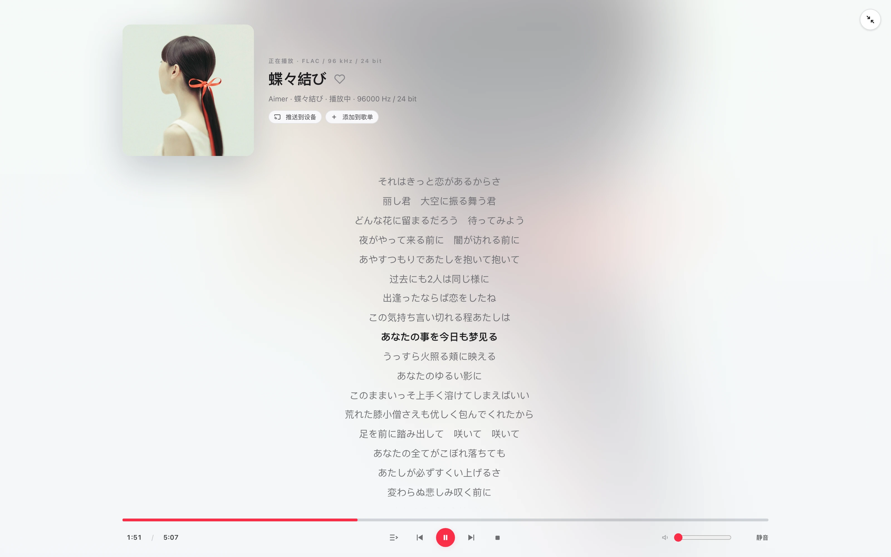
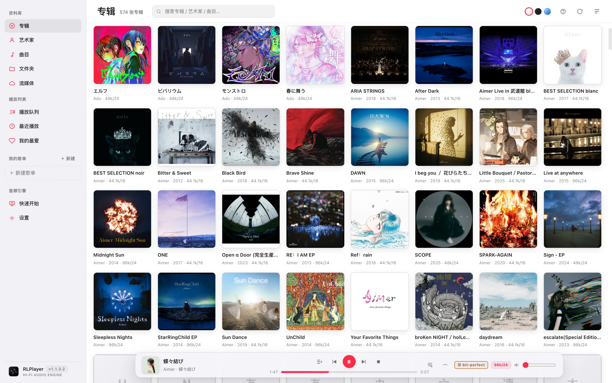
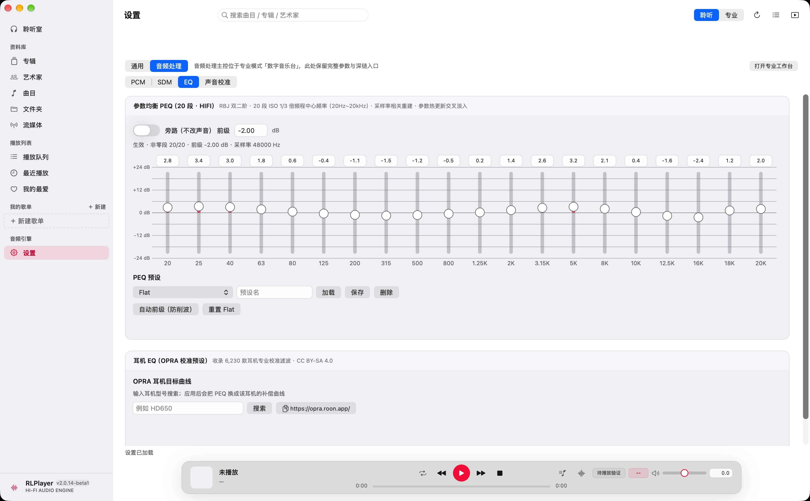
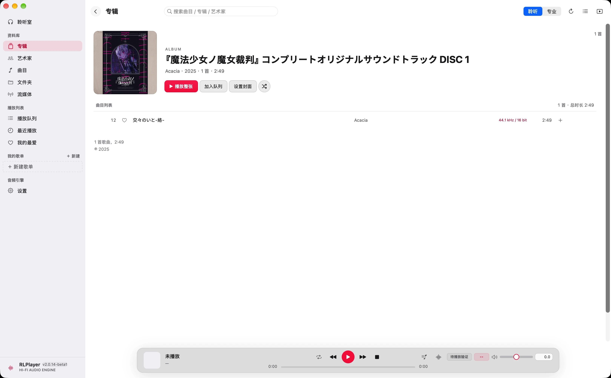

<p align="center">
  <a href="README.md"></a>
  <a href="README.zh-CN.md"></a>
</p>

<h1 align="center">RLPlayer for macOS</h1>

<p align="center">
  <b>Apple Silicon 原生 HiFi 播放引擎 · CoreAudio 独占物理格式锁 · 全链路自研 DSP · SDM/DSD · 20 段 PEQ</b>
</p>

<p align="center">
  
  <a href="https://github.com/BH2VOQ/RLPlayer-Mac/releases"></a>
  
  
  
  
</p>

<p align="center">
  <sub>当前版本：<b>v2.1.0</b> · <a href="https://github.com/BH2VOQ/RLPlayer-Mac/releases">发布与更新日志</a> · <a href="CONTRIBUTING.md">参与贡献</a></sub>
</p>

---

<p align="center">
  
</p>

| 52 | 4 | 6,230 | 251 | 0 |
| :---: | :---: | :---: | :---: | :---: |
| 升频预设 | SDM 调制器族 | OPRA 耳机曲线 | `ctest` 用例 | 运行时依赖 |

---

## 为什么选择 RLPlayer？（核心软件优势）

RLPlayer for macOS 是一个**以实测数值为判据、专为 Apple Silicon 原生打造的 HiFi 播放引擎**，不是 Electron 套壳，也不是第三方播放库的简单前端。

### 1. 100% 全链路自研 DSP，不靠“听感玄学”
- **多相 Sinc 升频**：支持任意有理比率，内置 **52 个命名预设**（Kaiser / Gaussian / Blackman-Harris 窗，线性 / 最小 / 混合相位及 tight 变体），实测阻带衰减 **−189.10 dB**、通带纹波 **0.0000 dB**。
- **抖动与噪声整形**：内置 `NS1` / `NS4` / `NS5` / `NS9` / `LNS15` 与 `RPDF` / `TPDF` / `Gauss1` / `Shaped`。在 44.1 kHz → 705.6 kHz 下，`NS9` 相对 TPDF 的带内信噪比收益达 **3.5 → 86.5 dB**。
- **SDM / DSD 调制器**：覆盖 Butterworth（`DSD5` / `DSD7`）、7 阶 Chebyshev、EC 误差反馈、AHM 多电平四大家族；`EC-5` 在 DSD256 下带内 SNR 达 **113.5 dB**（`AHM-8bit` 达 **131.6 dB**）。
- **零延迟分块卷积引擎**：均匀分块 FFT 卷积，与直接卷积的相对误差 **≤ 6.1e-14**。
- **20 段参量均衡器（PEQ）与过载保护**：ISO 1/3 倍频程中心频率、RBJ 双二阶滤波器（±24 dB 范围、0px 滞后拖拽曲线、按住 `⌥ Option` 微调频率）、自动前级防削波，以及过采样真峰值（ISP）预衰减保护。

### 2. 针对 Apple Silicon (`arm64`) 深度优化
- **NEON SIMD 与常驻多核 DSP 线程池**：核心重采样与 DSP 管线采用 ARM NEON SIMD 指令集加速，并由常驻多核 DSP 线程池调度，消除切歌时的线程创建抖动。
- **动态 Metal GPU 加速**：`librtagpu.dylib` 在运行时编译 MSL 内核，44.1k → 352.8k 升频提速 **29×**（44.1k → 384k 提速 **5.5×**）；卷积则依据 M 系列实测数据默认保留在 CPU 执行（生产 4096 样本块下 CPU 更快）。
- **零外部运行时依赖**：单 `.app` 安装包内已自带 LGPL 编译版 FFmpeg / FFprobe 8.1.2 与 Metal 内核，开箱即用。

### 3. macOS 真正的位完美（Bit-Perfect）硬件控制
- **CoreAudio 独占模式（Hog，默认开启）**：AUHAL + Hog 抢占 + **物理格式锁定**（`kAudioStreamPropertyPhysicalFormat` 写后读回校验），彻底绕过系统混音器重采样；遇到设备占用时如实报告 `DeviceBusy` 与占用进程 PID。
- **诚实的状态反馈（六态位完美徽标）**：分别判定直通、PCM→PCM、PCM→DSD、DSD→DSD 是否真正位完美；在 `float32` 设备或共享模式下绝不亮伪绿标，而是明确给出降级原因。
- **DoP 与网络串流**：
  - **DoP**：通过 24-bit 载波封装输出 DSD，绝不静默回退到共享模式。
  - **UPnP / DLNA**：支持 SSDP 发现、AVTransport 控制、渲染器能力适配及与源文件逐字节一致的本地供源。
  - **AirPlay（推送到设备）**：直连兼容的明文 AirPlay 1 / RAOP 接收器（`ALAC 44.1 kHz / 16 bit / 双声道`），带时钟同步与有界重传，并明确提示格式转换。

### 4. 原生轻量外壳、极速曲库与音质体检
- **单进程原生壳**：基于 `NSWindow + WKWebView` 与 AppKit 原生细节打磨，通过自定义 `rlplayer://app/` 协议通信，**本地播放期间主进程不监听任何 TCP 端口**；播放中关窗即刻隐藏并收紧停机等待至 2.5 秒内，杜绝卡死。
- **快 60×–250× 的原生标签解析**：FLAC / WAV / MP3 / OGG 直接二进制读取，无需逐个拉起 `ffprobe`；完整支持 CUE 整轨分轨（UTF-16 / UTF-8 / GBK 及 1/75 帧索引）。
- **6,230 款 OPRA 耳机曲线与音质体检**：一键导入 OPRA 耳机目标曲线；内置 `/api/track/health` 单曲体检（THD+N、本底噪声、声道相关性、单声道兼容性、Side/Mid 能量比及 4× 过采样真峰值 dBTP）。
- **六源元数据补全与 AI 增强**：支持 QQ 音乐、网易云音乐、iTunes、lrclib、dizzylab、Discogs 六源且可自定义优先级顺序；支持 OpenAI 兼容接口（DeepSeek、OpenAI、OpenRouter、硅基流动、本地 Ollama 等）。

---

## 一分钟看懂信号链

```text
FLAC 44.1 kHz / 16 bit
  → poly-sinc-gauss-long   ·  linear phase · 65535 taps
  → LNS15                  ·  noise shaping
  → EC-5                   ·  DSD256 modulator
  → DoP 11.2896 MHz        ·  24-bit carrier
  → CoreAudio Hog Mode     ·  physical format locked
```

以上每一级均可在 `/api/signal` 与 `rlplayer-playback.log` 中实时查看实际运行参数。

---

## 界面预览

<table>
  <tr>
    <td width="50%"></td>
    <td width="50%"></td>
  </tr>
  <tr>
    <td><b>曲库与播放</b> — 专辑网格、Subsonic 流媒体整合、CUE 分轨及实时信号链状态栏。</td>
    <td><b>DSP 与声音校准</b> — 升频滤波器、SDM 调制器、20 段可拖拽 PEQ 曲线与 6,230 款 OPRA 耳机曲线。</td>
  </tr>
</table>

<details>
<summary><b>展开更多界面预览（专辑详情）</b></summary>
<p align="center">
  
</p>
</details>

### 快捷键

| 按键 | 功能 |
| --- | --- |
| `Space` | 播放 / 暂停 |
| `←` / `→` | 上一首 / 下一首 |
| `Shift` + `←` / `→` | 快退 / 快进 5 秒 |
| `↑` / `↓` | 音量 ±0.5 dB（按住 `Shift` 为 ±0.1 dB） |
| `N` / `P` / `S` | 下一首 / 上一首 / 停止 |
| `L` | 歌词页 |
| `I` | 信号链 |
| `⌘` + `F` | 搜索 |
| `Esc` | 返回上一级 |

---

## 安装与系统要求

1. 前往 [Releases](https://github.com/BH2VOQ/RLPlayer-Mac/releases) 下载 `RLPlayer-<版本>-macOS-arm64.dmg`。
2. 双击挂载镜像，将 `RLPlayer` 拖入「应用程序」。
3. 首次打开如提示「无法验证开发者」，请右键点击 → **打开**，或在 **系统设置 → 隐私与安全性 → 仍要打开** 中放行。

| 项目 | 要求 |
| --- | --- |
| 系统 | macOS 13.0 及以上 |
| 芯片 | Apple Silicon（仅支持 `arm64`，不支持 Intel Mac） |
| 依赖 | 无（`.app` 内已打包 FFmpeg / FFprobe 与 Metal 内核） |

---

## 从源码构建与测试

```bash
# 前置：CMake ≥ 3.20、Xcode Command Line Tools
cmake -S . -B build-mac -DCMAKE_BUILD_TYPE=Release
cmake --build build-mac -j8
ctest --test-dir build-mac --output-on-failure     # 251 项测试

# 打包 .app（脚本内含架构、部署目标与签名门禁）
bash tools/make_app_mac.sh
# → dist-mac/RLPlayer.app
```

验证默认**不打开音频硬件**：优先走离线分析与 Null 后端，需出声的测试用例电平控制在 ≤ −60 dBFS。

---

## 客观实测指标

以下数据均在 Apple M4 / macOS 实测获得：

| 测试项 | 实测结果 |
| --- | --- |
| 升频阻带衰减（44.1k → 384k） | **−189.10 dB** |
| 升频通带纹波 | **0.0000 dB** |
| 升频最大谐波 | **−134.54 dBc** |
| DSD 源抽取 THD+N（DSD64 → 176.4k） | **99.37 dB** |
| EC-5 带内 SNR（DSD256） | **113.5 dB** |
| AHM-8bit 带内 SNR（DSD256） | **131.6 dB** |
| 20 段 PEQ 单段 +6 dB | **6.0000 dB** |
| 分块 FFT 卷积 vs 直接卷积 | 相对误差 **≤ 6.1e-14** |
| CoreAudio 共享路径逐位比对 | 16/24/32 bit 全部 **0 LSB** |
| UPnP 供源字节数 | **与源文件逐字节相同** |

---

## 已知限制

- **macOS 无原生 DSD 路径**：CoreAudio 仅定义 PCM，`dsdnative=1` 会明确报错而非静默降级；DSD 输出统一走 DoP。
- **位完美要求可锁定的整型物理格式**：仅提供 `float32` 物理格式的设备（如内置扬声器、部分虚拟声卡）无法逐位直通，界面会如实标注非 bit-perfect。
- **AirPlay 兼容性**：直接投送仅支持明文 AirPlay 1 / RAOP 接收器（`44.1 kHz / 16 bit / 双声道` ALAC），不支持 AirPlay 2 多房间、密码认证及强制加密接收器。
- **UPnP 与 CUE 分轨**：UPnP 渲染器只能拉取独立文件，投送期间点击 CUE 分轨曲目会明确报错。
- **GPU 升频精度**：Apple GPU 不支持双精度浮点，Metal 升频走 float32（与 CPU 差异约 −132.6 dB）。
- **仅限 Apple Silicon**：不支持 `x86_64` 架构。

---

## 文档与项目渊源

- [GPU 精度实测](<docs/GPU精度实测.md>) · [GPU 卷积与升频效率细查](<docs/GPU卷积与升频效率细查.md>)
- [CONTRIBUTING.md](CONTRIBUTING.md) · [SECURITY.md](SECURITY.md) · [CODE_OF_CONDUCT.md](CODE_OF_CONDUCT.md)

本仓库为 **RLPlayer 独立 macOS 分支**，衍生自上游 [okhuoyanyan/RLPlayer2](https://github.com/okhuoyanyan/RLPlayer2)（Windows 版），音频输出、Metal GPU 与原生窗口外壳均针对 macOS 独立重写。

---

## 开源协议

本项目基于 **GNU General Public License v3.0 or later**（`GPL-3.0-or-later`）开源，详见 [LICENSE](LICENSE)、[COPYRIGHT.md](COPYRIGHT.md) 与 [OPRA-NOTICE.txt](OPRA-NOTICE.txt)。

- FFmpeg / FFprobe 8.1.2（`LGPL-2.1-or-later`）与 LAME（`LGPL-2.0-or-later`）以独立可执行子进程随包分发，主程序未静态/动态链接 `libav*`。
- OPRA 耳机 EQ 数据采用 `CC BY-SA 4.0` 协议。

<p align="center">
  <sub><a href="README.md">English</a> · <b>简体中文</b> (当前)</sub>
</p>
