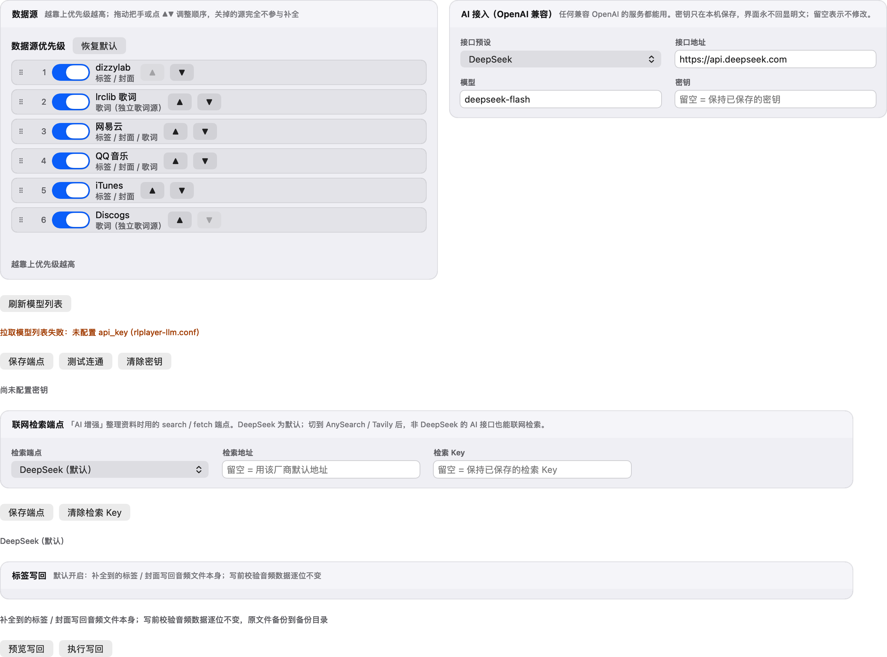
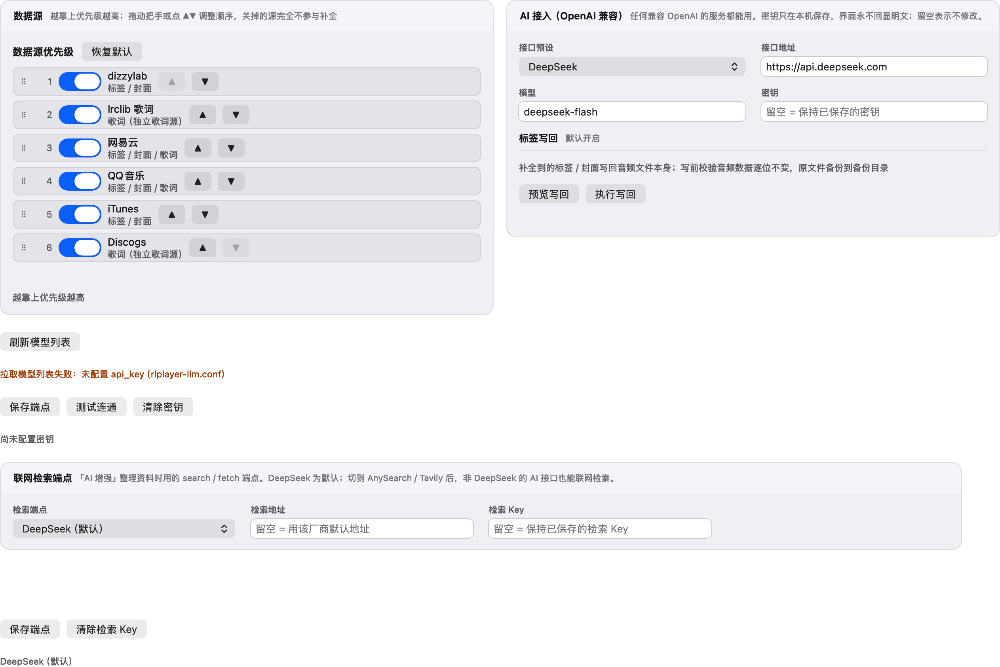

# 第12项 · 元数据页「标签写回」并入卡片、整页排版对齐（2026-11-13）

> 判据：`tests/test_native_writeback_card.mm`（ctest 名 `native_writeback_card`）——
> 真设置页（隔离 state/library、`backend=null`、`volume=-120`）、离屏、不发声（铁律②）。
> web 基准：`src/net/ui_script.h:10264-10272` —— 「标签写回」是「AI 接入（OpenAI 兼容）」
> 卡体内的 `.mh.sub` 子段（标题 + 说明 + 两个按钮 + 状态行都在同一卡体）。

## 红→绿

| 阶段 | 命令 | 结果 | 证据 |
|---|---|---|---|
| 旧码（红） | `./build-mac/test_native_writeback_card` | **3 passed, 1 failed**（结构判据：无共同卡片容器） | `evidence/native-item12-red-20261113.log` |
| 新码（绿） | `./build-mac/test_native_writeback_card` | **19 passed, 0 failed** | `evidence/native-item12-green-20261113.log` |

旧码红的核心断言（不是"能跑就行"）：
```
[FAIL] 【结构】标题/说明/「预览写回」/「执行写回」是同一卡片容器的共同后代（不是页面并列）
       — cards=5 dry.superview=NSStackView desc.superview=NSStackView
```
复现了用户描述：一个**空壳**「标签写回」卡片（只有标题条）+ 页面并列的说明与两个按钮。

## 离屏渲染前后对比

| 旧码（before） | 新码（after） |
|---|---|
|  |  |

（图由同一条生产渲染路径 `cacheDisplayInRect:` 离屏导出，`RLP_WB_SNAP=<path>` 控制；
不是手绘示意图。）

## 结构与几何判据（新码 19/19）

结构（同一卡片的共同后代）：
- 「标签写回」子标题、说明、`sp_wbdry`（预览写回）、`sp_wbapply`（执行写回）全部
  `IsDescendantOf:` 同一 `RLPSettingsGroup`；
- 该卡片的标题是「AI 接入（OpenAI 兼容）」⟹ 与 web 同位置（不是自成一块）；
- 按钮祖先链经过该卡片（旧码是 `sp_metaadv` 页面并列）。

几何（与同页其它卡片实测一致，±2pt）：

| 量 | 实测 | 对照 | 结论 |
|---|---|---|---|
| 子标题块左内边距 | 16.00 | 卡片内容区 16（web `.sgbody` 16） | OK |
| 说明左内边距 | 14.00（NSTextField frame 含 2pt alignment inset ⟹ 文字在 16） | 16 ±2 | OK |
| 预览写回按钮左内边距 | 16.00 | 16 ±2 | OK |
| 说明左内边距 vs 同页「联网检索端点」字段 | 14 vs 16（差值 2） | ±2 | OK |
| 按钮高度 | 24.00 | 同页「保存端点」按钮 24 | OK |
| 预览↔执行 按钮间距 | 8.00 | 同页另一卡片按钮行 8 | OK |
| 子标题块→说明 竖向间距 | 14.00 | 网格 gap 14（同页卡片一致） | OK |
| 说明→按钮行 竖向间距 | 14.00 | 网格 gap 14 | OK |
| 右边界 | 不越界（≥16） | 16 | OK |

## 写回语义未弱化（逐条保留）

- 预览写回 / 执行写回两个动作按钮与原 identifier（`sp_wbdry` / `sp_wbapply` / `sp_wbmsg` /
  `sp_wbdesc`）全部保留，`parity_scan.py --check` removed=1/ok、missing=0，没有为了排版删功能；
- 文案原样保留：`补全到的标签 / 封面写回音频文件本身；写前校验音频数据逐位不变，原文件备份到备份目录`；
- 动作实现（`onWritebackDry:` / `onWritebackApply:`）未改，忙态禁按钮与 800ms 轮询逻辑未动。

## 顺手修掉的真缺陷（同一项）

离屏对比图第一次导出时发现按钮行被压扁（「执行…」截断、「预览写回」0 宽）：
原因是把状态标签塞进横向 `NSStackView` 并撑满卡片宽度，状态文本的内在宽度把两个按钮压掉。
改为卡片的通用按钮行原语（`addButtonRow:`，与「保存并连接 / 测试连通 / 清除 Key」同一套），
状态行单独一行。这条是**渲染图抓到的**，几何判据没有覆盖到（已记入假绿清单：几何全绿≠渲染正确）。

## 如实挂账

- 实测（离线/真页面）：结构 + 几何 19 项全绿；前后两张离屏 PNG。
- 未实机：真实窗口缩放下的两列回流（`.meta-adv-grid` 窄屏单列）与浅色主题观感仍需实机看一眼。
